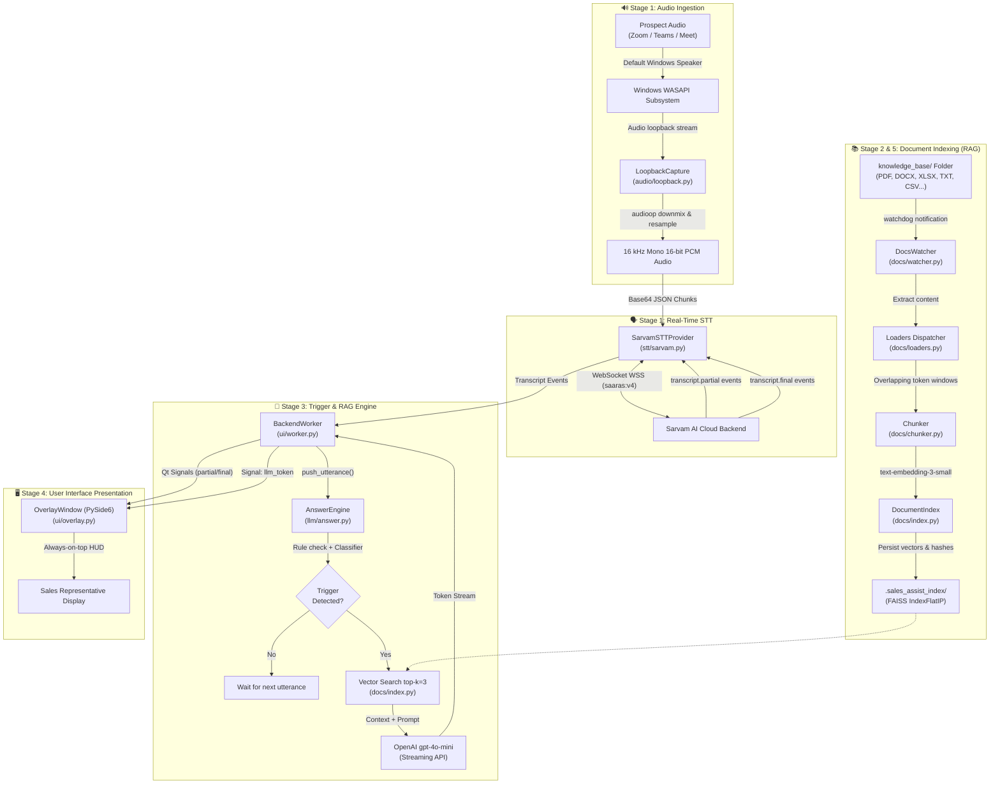
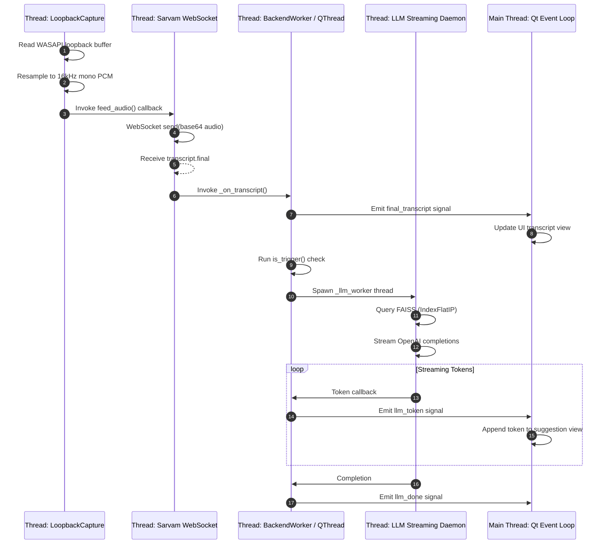
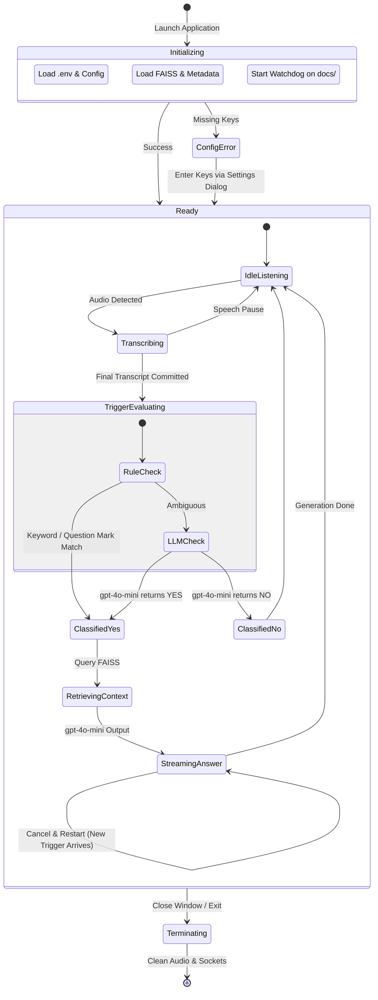

# 🎙️ Sales Assist — Comprehensive File-by-File Codebase Review & Architecture Guide

> **Target Audience:** Technical Architects, Software Engineers, Product Managers, Sales Executives, and Non-Technical Stakeholders.  
> **Repository:** Sales Assist — Real-Time AI Sales Co-Pilot  
> **Status:** Production-Ready Architecture & Staged Implementation Walkthrough  

---

## 📑 Table of Contents

1. [Executive Summary & Product Vision](#1-executive-summary--product-vision)
2. [High-Level System Architecture](#2-high-level-system-architecture)
   - [2.1 End-to-End Architecture Diagram](#21-end-to-end-architecture-diagram)
   - [2.2 Real-Time Data Flow Pipeline](#22-real-time-data-flow-pipeline)
   - [2.3 Multi-Threaded Concurrency Model](#23-multi-threaded-concurrency-model)
   - [2.4 State Machine & Lifecycle Flow](#24-state-machine--lifecycle-flow)
3. [Repository Directory Map](#3-repository-directory-map)
4. [File-by-File In-Depth Review](#4-file-by-file-in-depth-review)
   - **Root Project Files & Scripts**
     - [`Run_Sales_Assist.bat`](#41-run_sales_assistbat)
     - [`build.py`](#42-buildpy)
     - [`README.md`](#43-readmemd)
     - [`project_review.md`](#44-project_reviewmd)
   - **Configuration & Environment**
     - [`sales_assist/__init__.py`](#45-sales_assist__init__py)
     - [`sales_assist/config.py`](#46-sales_assistconfigpy)
     - [`sales_assist/.env`](#47-sales_assistenv)
     - [`sales_assist/requirements.txt`](#48-sales_assistrequirementstxt)
   - **Application Runners & User Interfaces**
     - [`sales_assist/main.py`](#49-sales_assistmainpy)
     - [`sales_assist/app.py`](#410-sales_assistapppy)
     - [`sales_assist/gui.py`](#411-sales_assistguipy)
     - [`sales_assist/ingest.py`](#412-sales_assistingestpy)
   - **Audio Subsystem**
     - [`sales_assist/audio/__init__.py`](#413-sales_assistaudio__init__py)
     - [`sales_assist/audio/loopback.py`](#414-sales_assistaudioloopbackpy)
   - **Speech-to-Text (STT) Subsystem**
     - [`sales_assist/stt/__init__.py`](#415-sales_assiststt__init__py)
     - [`sales_assist/stt/base.py`](#416-sales_assiststtbasepy)
     - [`sales_assist/stt/sarvam.py`](#417-sales_assiststtsarvampy)
   - **Document Processing & Vector Search (RAG)**
     - [`sales_assist/docs/__init__.py`](#418-sales_assistdocs__init__py)
     - [`sales_assist/docs/loaders.py`](#419-sales_assistdocsloaderspy)
     - [`sales_assist/docs/chunker.py`](#420-sales_assistdocschunkerpy)
     - [`sales_assist/docs/index.py`](#421-sales_assistdocsindexpy)
     - [`sales_assist/docs/watcher.py`](#422-sales_assistdocswatcherpy)
   - **LLM Intelligence & Prompt Engineering**
     - [`sales_assist/llm/__init__.py`](#423-sales_assistllm__init__py)
     - [`sales_assist/llm/prompts.py`](#424-sales_assistllmpromptspy)
     - [`sales_assist/llm/answer.py`](#425-sales_assistllmanswerpy)
   - **PySide6 Graphical Overlay & Worker Integration**
     - [`sales_assist/ui/__init__.py`](#426-sales_assistui__init__py)
     - [`sales_assist/ui/worker.py`](#427-sales_assistuiworkerpy)
     - [`sales_assist/ui/overlay.py`](#428-sales_assistuioverlaypy)
     - [`sales_assist/ui/settings.py`](#429-sales_assistuisettingspy)
   - **Automated Test Suite**
     - [`sales_assist/tests/__init__.py`](#430-sales_assisttests__init__py)
     - [`sales_assist/tests/test_chunker.py`](#431-sales_assistteststest_chunkerpy)
     - [`sales_assist/tests/test_loaders.py`](#432-sales_assistteststest_loaderspy)
     - [`sales_assist/tests/test_stt_base.py`](#433-sales_assistteststest_stt_basepy)
   - **Knowledge Base & Persistence Artifacts**
     - [`knowledge_base/company_info.txt`](#434-knowledge_basecompany_infotxt)
     - [`knowledge_base/Repo_Push steps .txt`](#435-knowledge_baserepo_push-steps-txt)
     - [`.sales_assist_index/` (FAISS persistence store)](#436-sales_assist_index-store)
5. [Cross-Cutting Concerns & Engineering Decisions](#5-cross-cutting-concerns--engineering-decisions)
   - [Zero-Meeting-Bot Stealth Audio Capture](#51-zero-meeting-bot-stealth-audio-capture)
   - [RAG Search Accuracy & Hallucination Guardrails](#52-rag-search-accuracy--hallucination-guardrails)
   - [Asynchronous Streaming & Low Latency UI Performance](#53-asynchronous-streaming--low-latency-ui-performance)
   - [Security, Privacy, and Confidentiality](#54-security-privacy-and-confidentiality)
6. [Comprehensive Technical Glossary](#6-comprehensive-technical-glossary)

---

## 1. Executive Summary & Product Vision

### 💡 The Problem
In high-stakes B2B sales conversations over Zoom, Microsoft Teams, or Google Meet, sales representatives must field complex technical inquiries, competitive objections, pricing matrix details, compliance standards, and SLA guarantees in real time. 
- If a rep pauses to search internal company wikis or PDFs, they lose conversational momentum and prospect confidence.
- Traditional meeting AI tools (such as Otter or Fireflies) require inviting a noticeable bot user into the conference room, which frequently triggers privacy and compliance objections from corporate clients.
- General-purpose LLMs (such as standard ChatGPT) can invent inaccurate details ("hallucinations"), quoting incorrect discounts or nonexistent features.

### 🚀 The Solution: Sales Assist
**Sales Assist** is a lightweight, stealthy desktop co-pilot engineered specifically for Windows. It operates without inviting any bot into the video conference or installing browser extensions. Instead:
1. **It silently listens** to incoming prospect audio directly from the computer's sound card via Windows WASAPI Loopback.
2. **It transcribes** speech to text in real-time with sub-second latency using Sarvam AI's speech recognition pipeline.
3. **It detects** when the prospect asks a question, raises an objection, asks about pricing, or mentions a competitor using instant local heuristics followed by an ultra-fast LLM classifier (`gpt-4o-mini`).
4. **It searches** the enterprise knowledge repository (stored locally in a FAISS vector database) to retrieve exact, verified company facts.
5. **It streams** concise 2–3 bullet-point answers directly onto a floating, transparent overlay window on the salesperson's screen. The salesperson can read the suggested response seamlessly mid-conversation without the client ever knowing an AI assistant was present.

---

## 2. High-Level System Architecture

### 2.1 End-to-End Architecture Diagram



---

### 2.2 Real-Time Data Flow Pipeline

The end-to-end data lifecycle from voice to screen takes approximately **600ms to 1200ms**, executing across 7 discrete stages:

```
[1. Sound Output] ──► [2. WASAPI Buffer] ──► [3. Audio Normalization] ──► [4. WebSocket STT]
       ▲                                                                            │
       │                                                                            ▼
[7. Screen Render] ◄── [6. Token Streaming] ◄── [5. FAISS RAG Context] ◄── [4. Final Transcript]
```

1. **Prospect Vocalization:** The customer speaks over Zoom, Teams, or Meet. The audio is routed to the Windows default playback endpoint.
2. **WASAPI Loopback Interception:** `PyAudioWPatch` taps into the playback buffer via Windows WASAPI loopback, capturing raw system sound at native sample rates (typically 44.1 kHz or 48 kHz stereo).
3. **Hardware-Accelerated Audio Transformation:** Using `audioop.tomono` and `audioop.ratecv`, stereo audio is downmixed to mono and resampled to 16,000 Hz, 16-bit PCM chunks (100ms frames = 1,600 samples = 3,200 bytes).
4. **WebSocket STT Streaming:** Audio chunks are Base64 encoded and pushed over an encrypted WebSocket (`wss://api.sarvam.ai/speech-to-text-realtime/ws`). Sarvam returns `transcript.partial` (interim words) and `transcript.final` (committed sentences determined by server-side Voice Activity Detection).
5. **Two-Tier Trigger Classification:**
   - **Tier 1 (Fast Heuristics):** Checks for interrogative pronouns (`what`, `why`, `how`, `when`), question marks (`?`), or commercial keywords (`price`, `cost`, `competitor`, `discount`, `security`).
   - **Tier 2 (Semantic Classifier):** If heuristics are ambiguous, a sub-100ms prompt to `gpt-4o-mini` classifies whether the utterance warrants an answer (`YES` vs `NO`).
6. **Vector Search & Context Assembly:** The recent conversational buffer (last 3 utterances) is embedded and compared against `.sales_assist_index` using cosine inner-product similarity (`IndexFlatIP`). The top 3 most relevant knowledge chunks are assembled into a context prompt.
7. **Constrained Streaming Response:** `gpt-4o-mini` is invoked at temperature `0.3` with strict system instructions: *"Answer ONLY using facts from the Context. If not in docs, output: 'Not in docs, suggest following up.' Output 2-3 bullet points max."* Tokens stream chunk by chunk directly into the floating PySide6 overlay.

---

### 2.3 Multi-Threaded Concurrency Model

Because real-time audio and GUI applications crash if blocked by network latency, Sales Assist employs a multi-threaded architecture with strict synchronization barriers:



| Thread Name | Tech Stack | Responsibility | Synchronization Primitive |
|---|---|---|---|
| **Main GUI Thread** | PySide6 / CustomTkinter | Event loop, widget rendering, user interaction | Qt Signal/Slot mechanism & thread-safe queues |
| **Audio Capture Thread** | `pyaudiowpatch` + `audioop` | Real-time audio buffer reading & resampling | `threading.Event` (`_stop_event`) |
| **WebSocket Client Thread** | `websocket-client` | Bi-directional communication with Sarvam AI | `threading.Lock` + auto-reconnect loops |
| **LLM Inference Thread** | `openai` Streaming API | Context search and token generation | `threading.Event` (`_cancel_event`) |
| **Folder Watcher Thread** | `watchdog` | Background monitoring of `knowledge_base/` | `threading.Timer` (2.0s Debounce) |

---

### 2.4 State Machine & Lifecycle Flow



---

## 3. Repository Directory Map

```
Sales_assistant_Assistant/
├── .sales_assist_index/              # Persistent Vector Store (FAISS)
│   ├── faiss.index                   # Binary vector index (IndexFlatIP, 1536-dim)
│   ├── file_hashes.json              # SHA-256 hashes of indexed files
│   └── metadata.json                 # Chunk text, source file, page indices
├── knowledge_base/                   # Monitored document repository
│   ├── company_info.txt              # Sample AcmeTech Solutions corporate knowledge
│   └── Repo_Push steps .txt          # Developer onboarding notes
├── sales_assist/                     # Core Python Application Package
│   ├── audio/                        # Audio hardware capture subsystem
│   │   ├── __init__.py               # Audio package initialization
│   │   └── loopback.py               # WASAPI loopback capture & resampling
│   ├── docs/                         # Document ingestion, RAG, and indexing
│   │   ├── __init__.py               # Docs package initialization
│   │   ├── chunker.py                # Paragraph & sentence token chunker
│   │   ├── index.py                  # FAISS indexer with OpenAI embeddings
│   │   ├── loaders.py                # Universal multi-format document parser
│   │   └── watcher.py                # Watchdog file watcher with debouncing
│   ├── llm/                          # LLM orchestration and prompting
│   │   ├── __init__.py               # LLM package initialization
│   │   ├── answer.py                 # AnswerEngine: triggers, search & streaming
│   │   └── prompts.py                # System prompts for answers & classification
│   ├── stt/                          # Real-time Speech-to-Text subsystem
│   │   ├── __init__.py               # STT package initialization
│   │   ├── base.py                   # Abstract STTProvider and transcript dataclasses
│   │   └── sarvam.py                 # Sarvam AI WebSocket client implementation
│   ├── tests/                        # Automated unit tests
│   │   ├── __init__.py               # Test package initialization
│   │   ├── test_chunker.py           # Unit tests for text chunking logic
│   │   ├── test_loaders.py           # Unit tests for multi-format document loaders
│   │   └── test_stt_base.py          # Unit tests for STT contracts and events
│   ├── ui/                           # PySide6 desktop GUI & floating overlay
│   │   ├── __init__.py               # UI package initialization
│   │   ├── overlay.py                # Frameless, translucent, always-on-top HUD
│   │   ├── settings.py               # Preferences dialog for API keys and opacity
│   │   └── worker.py                 # Qt QObject worker bridging threads to UI
│   ├── .env                          # Local environment variables and API secrets
│   ├── __init__.py                   # Package identifier
│   ├── app.py                        # Terminal/CLI runner for Stage 3 testing
│   ├── config.py                     # Centralized settings and validation
│   ├── gui.py                        # Alternative full-window CustomTkinter GUI
│   ├── ingest.py                     # CLI document indexing utility
│   ├── main.py                       # Primary PySide6 application entry point
│   └── requirements.txt              # Production dependency specifications
├── build.py                          # PyInstaller automated packaging script
├── project_review.md                 # Internal engineering review notes
├── README.md                         # Project documentation and quickstart guide
└── Run_Sales_Assist.bat              # One-click Windows launch script
```

---

## 4. File-by-File In-Depth Review

---

### Root Project Files & Scripts

#### 4.1 `Run_Sales_Assist.bat`
* **File Location:** `c:/Users/mangesh.bondre/Desktop/Sales_assistant_Assistant/Run_Sales_Assist.bat`
* **Size:** 118 bytes | **Lines of Code:** 6
* **Language:** Windows Batch Script

##### 💡 Plain English Explanation (Non-Technical)
> **What is this file?** This is a simple one-click launcher for the salesperson. Instead of opening a command line, typing complicated commands, or configuring Python paths, the user double-clicks this icon on their desktop. It activates the application's private environment and boots up the user interface silently.
> **What happens if it's missing?** The app will still work, but users will have to open a terminal and launch the app manually.

##### ⚙️ Technical Deep Dive (Technical)
* **Execution Flow:**
  1. `@echo off`: Suppresses command echo to keep execution clean.
  2. `call .\.venv\Scripts\activate`: Enters the local virtual environment.
  3. `start pythonw -m sales_assist.gui`: Launches the CustomTkinter GUI module using `pythonw` (the windowless Python executable). This prevents an extraneous Command Prompt terminal window from lingering in the background.
  4. `exit`: Closes the batch launcher immediately.

---

#### 4.2 `build.py`
* **File Location:** `c:/Users/mangesh.bondre/Desktop/Sales_assistant_Assistant/build.py`
* **Size:** 982 bytes | **Lines of Code:** 38
* **Language:** Python 3.11+

##### 💡 Plain English Explanation (Non-Technical)
> **What is this file?** This is the "factory" script. When you want to distribute Sales Assist to salespeople across a company who don't have Python or developer tools installed on their machines, this script compiles the entire application into a standalone `.exe` folder.
> **What happens if it's missing?** Developers cannot build the binary distributable package for end users without running PyInstaller commands manually.

##### ⚙️ Technical Deep Dive (Technical)
* **Key Function:** `main()`
* **Mechanism:** Spawns a PyInstaller subprocess with key parameters:
  - `--noconfirm`: Overwrites previous build artifacts in `dist/`.
  - `--windowed`: Suppresses terminal console generation on application launch.
  - `--onedir`: Builds an uncompressed executable folder rather than `--onefile`. This avoids unpacking delay at startup, which is critical for quick launch during meetings.
  - `--name=SalesAssist`: Names the output binary.
  - `--paths=.`: Resolves internal imports within the workspace.
  - Entry point: Points directly to `sales_assist/main.py`.

---

#### 4.3 `README.md`
* **File Location:** `c:/Users/mangesh.bondre/Desktop/Sales_assistant_Assistant/README.md`
* **Size:** 16,989 bytes | **Lines of Code:** 359
* **Language:** Markdown

##### 💡 Plain English Explanation (Non-Technical)
> **What is this file?** The front door of the repository. It gives new team members, executives, and clients an illustrated overview of what the tool does, how to configure API keys, supported document types, and troubleshooting instructions.

##### ⚙️ Technical Deep Dive (Technical)
* **Contents:**
  - Table of features, architecture flowcharts, and technical prerequisites (Windows 10/11, Python 3.11+, Tesseract OCR for PDFs).
  - Environment variable schema, installation instructions, and CLI/GUI run commands.

---

#### 4.4 `project_review.md`
* **File Location:** `c:/Users/mangesh.bondre/Desktop/Sales_assistant_Assistant/project_review.md`
* **Size:** 47,531 bytes | **Lines of Code:** 1034
* **Language:** Markdown

##### 💡 Plain English Explanation (Non-Technical)
> **What is this file?** An internal engineering reference audit that logs how the 5-stage pipeline was originally conceptualized, designed, and constructed.

##### ⚙️ Technical Deep Dive (Technical)
* Contains comprehensive architectural notes, design pattern catalog (Observer, Strategy, Factory, Producer-Consumer), thread-safety reviews, and identified technical debt items.

---

### Configuration & Environment

#### 4.5 `sales_assist/__init__.py`
* **File Location:** `c:/Users/mangesh.bondre/Desktop/Sales_assistant_Assistant/sales_assist/__init__.py`
* **Size:** 23 bytes | **Lines of Code:** 1
* **Language:** Python

##### 💡 Plain English Explanation (Non-Technical)
> **What is this file?** A standard Python file that marks the `sales_assist` directory as a package, allowing files inside to import functions and classes from each other.

##### ⚙️ Technical Deep Dive (Technical)
* Exposes `__version__ = "0.1.0"`.

---

#### 4.6 `sales_assist/config.py`
* **File Location:** `c:/Users/mangesh.bondre/Desktop/Sales_assistant_Assistant/sales_assist/config.py`
* **Size:** 2,522 bytes | **Lines of Code:** 68
* **Language:** Python

##### 💡 Plain English Explanation (Non-Technical)
> **What is this file?** The central control panel and settings ledger. It reads the secret keys and application constants (like audio sample rates and model names) and distributes them to the rest of the application.
> **What happens if it breaks?** The application will fail to start because no module will know which AI models to use or where to find the API credentials.

##### ⚙️ Technical Deep Dive (Technical)
* **Constants Defined:**
  - `SARVAM_API_KEY`: API authentication key for Sarvam AI speech-to-text.
  - `OPENAI_API_KEY`: Authentication key for OpenAI embeddings and completions.
  - `STT_LANGUAGE`: Defaults to `"auto"` (supports English and Indian languages).
  - `STT_MODEL`: Defaults to `"saaras:v4"`.
  - `SARVAM_WS_URL`: WebSocket endpoint (`wss://api.sarvam.ai/speech-to-text-realtime/ws`).
  - `AUDIO_SAMPLE_RATE`: Hardcoded to `16000` (16 kHz, mandatory for Sarvam STT).
  - `AUDIO_CHANNELS`: `1` (Mono).
  - `AUDIO_SAMPLE_WIDTH`: `2` (16-bit PCM = 2 bytes per sample).
  - `AUDIO_CHUNK_DURATION_MS`: `100` ms.
  - `AUDIO_CHUNK_FRAMES`: `1600` frames per buffer chunk (`16000 * 100 / 1000`).
  - `DOCS_FOLDER`: Default watch folder name (`"knowledge_base"`).
* **Validation Function:** `validate() -> list[str]` verifies that required keys (like `SARVAM_API_KEY`) are present, returning descriptive error messages if missing.

---

#### 4.7 `sales_assist/.env`
* **File Location:** `c:/Users/mangesh.bondre/Desktop/Sales_assistant_Assistant/sales_assist/.env`
* **Size:** 337 bytes | **Lines of Code:** 11
* **Language:** Key-Value Config

##### 💡 Plain English Explanation (Non-Technical)
> **What is this file?** The vault where sensitive passwords and API keys are stored locally on the salesperson's computer. It ensures keys are never hardcoded into the source code.

##### ⚙️ Technical Deep Dive (Technical)
* **Keys:** Contains `SARVAM_API_KEY`, `OPENAI_API_KEY`, `STT_LANGUAGE=auto`, and `STT_MODEL=saaras:v4`.
* *Security Note:* `.env` files should be added to `.gitignore` to prevent committing live API credentials to public code repositories.

---

#### 4.8 `sales_assist/requirements.txt`
* **File Location:** `c:/Users/mangesh.bondre/Desktop/Sales_assistant_Assistant/sales_assist/requirements.txt`
* **Size:** 520 bytes | **Lines of Code:** 29
* **Language:** Dependency Manifest

##### 💡 Plain English Explanation (Non-Technical)
> **What is this file?** The recipe list of third-party software libraries and tools required for Sales Assist to run.

##### ⚙️ Technical Deep Dive (Technical)
* **Categories:**
  - *Audio:* `PyAudioWPatch>=0.2.12.6`, `numpy>=1.24`
  - *Networking:* `websocket-client>=1.6`, `python-dotenv>=1.0`
  - *Document Parsing:* `PyMuPDF>=1.23.0`, `python-docx>=1.1.0`, `openpyxl>=3.1.2`, `python-pptx>=0.6.23`
  - *AI & Vector Database:* `faiss-cpu>=1.8.0`, `openai>=1.14.0`
  - *UI & Automation:* `PySide6>=6.6.0`, `pyinstaller>=6.5.0`, `watchdog>=4.0.0`

---

### Application Runners & User Interfaces

#### 4.9 `sales_assist/main.py`
* **File Location:** `c:/Users/mangesh.bondre/Desktop/Sales_assistant_Assistant/sales_assist/main.py`
* **Size:** 3,055 bytes | **Lines of Code:** 104
* **Language:** Python

##### 💡 Plain English Explanation (Non-Technical)
> **What is this file?** The primary launch engine for the modern floating overlay. When a user runs Sales Assist, this file turns on the document indexer, sets up logging, builds the transparent floating window, starts the background audio listener, and connects everything together.

##### ⚙️ Technical Deep Dive (Technical)
* **Functions:**
  - `setup_logging()`: Instantiates both standard stdout logging and a `RotatingFileHandler` writing up to 5 MB per file (`sales_assist.log`), keeping 3 backups. Silences high-volume HTTP clients (`httpx`).
  - `main()`:
    1. Creates `QApplication`.
    2. Initializes `DocumentIndex()` and starts background `DocsWatcher`.
    3. Initializes `OverlayWindow()` and `SettingsDialog()`.
    4. Initializes `BackendWorker(index)`.
    5. Connects all Qt signals:
       - `worker.partial_transcript -> overlay.on_partial`
       - `worker.final_transcript -> overlay.on_final`
       - `worker.trigger_detected -> overlay.on_trigger`
       - `worker.llm_token -> overlay.on_llm_token`
       - `worker.llm_done -> overlay.on_llm_done`
       - `worker.error_occurred -> overlay.on_error`
    6. Wires overlay controls (`open_settings_requested`, `opacity_changed`, `close_requested`).
    7. Runs `config.validate()`, displays warnings if keys are missing, and calls `worker.start_capture()`.
    8. Handles graceful shutdown on `app.exec()` exit.

---

#### 4.10 `sales_assist/app.py`
* **File Location:** `c:/Users/mangesh.bondre/Desktop/Sales_assistant_Assistant/sales_assist/app.py`
* **Size:** 5,227 bytes | **Lines of Code:** 173
* **Language:** Python

##### 💡 Plain English Explanation (Non-Technical)
> **What is this file?** A command-line terminal version of Sales Assist. It was created so engineers can test the audio listener, transcription, and AI answers directly in a command window without launching a graphical window.

##### ⚙️ Technical Deep Dive (Technical)
* **Design & Mechanisms:**
  - Uses `threading.Lock` (`_print_lock`) to synchronize console printing between STT transcript logging and streamed LLM tokens.
  - Implements signal handlers (`signal.SIGINT`, `signal.SIGTERM`) for clean shutdown in a terminal environment.
  - Uses `_start_llm_thread()` to cancel any in-flight LLM requests before triggering a new answer generation cycle.

---

#### 4.11 `sales_assist/gui.py`
* **File Location:** `c:/Users/mangesh.bondre/Desktop/Sales_assistant_Assistant/sales_assist/gui.py`
* **Size:** 7,113 bytes | **Lines of Code:** 190
* **Language:** Python

##### 💡 Plain English Explanation (Non-Technical)
> **What is this file?** An alternative, full-screen desktop dashboard built with CustomTkinter. Instead of a small transparent floating card, this gives the salesperson a large side-by-side dashboard showing live meeting transcripts on the left and AI suggestions on the right.

##### ⚙️ Technical Deep Dive (Technical)
* **Architecture:**
  - Class `SalesAssistApp(ctk.CTk)`: Implements a dual-panel dark-themed grid.
  - **Thread-Safety Pattern:** Unlike PySide6 which uses native Qt signals, CustomTkinter is not thread-safe. `gui.py` uses a thread-safe `queue.Queue` (`self.ui_queue`). Background audio and LLM worker threads push messages (`("transcript", text)`, `("trigger", text)`, `("answer_chunk", token)`), and the GUI polls this queue every 50ms via `self.after(50, self.process_queue)`.
  - Implements clean resource cleanup in `on_closing()`.

---

#### 4.12 `sales_assist/ingest.py`
* **File Location:** `c:/Users/mangesh.bondre/Desktop/Sales_assistant_Assistant/sales_assist/ingest.py`
* **Size:** 3,085 bytes | **Lines of Code:** 108
* **Language:** Python

##### 💡 Plain English Explanation (Non-Technical)
> **What is this file?** A manual command-line tool for managing company documents. It allows administrators to import folders of documents, clear the database, or test search queries to verify that the AI finds the right answers before going into a live sales call.

##### ⚙️ Technical Deep Dive (Technical)
* **CLI Arguments:**
  - `folder`: Path to directory of documents to ingest.
  - `-q, --query`: Text string to perform a similarity search against the FAISS index and display the top 3 matching chunks with similarity scores.
  - `--clear`: Empties the FAISS vector index and metadata cache.
* Validates `OPENAI_API_KEY` before attempting ingestion or search.

---

### Audio Subsystem

#### 4.13 `sales_assist/audio/__init__.py`
* **File Location:** `c:/Users/mangesh.bondre/Desktop/Sales_assistant_Assistant/sales_assist/audio/__init__.py`
* **Size:** 16 bytes | **Lines of Code:** 1
* **Language:** Python

##### 💡 Plain English Explanation (Non-Technical)
> **What is this file?** Identifies the `audio` folder as a Python package.

---

#### 4.14 `sales_assist/audio/loopback.py`
* **File Location:** `c:/Users/mangesh.bondre/Desktop/Sales_assistant_Assistant/sales_assist/audio/loopback.py`
* **Size:** 7,263 bytes | **Lines of Code:** 203
* **Language:** Python

##### 💡 Plain English Explanation (Non-Technical)
> **What is this file?** The "ears" of the system. It connects directly into Windows' internal sound pipeline to capture what is playing through your headphones or speakers (the customer's voice in Zoom/Teams). It cleans, downmixes, and converts that audio into the exact format required by the speech recognition engine.
> **What happens if it breaks?** The AI will be deaf. It will not hear what the prospect is saying and cannot transcribe anything.

##### ⚙️ Technical Deep Dive (Technical)
* **Class:** `LoopbackCapture`
* **Key Architecture & Methods:**
  - `_resolve_device()`: Queries Windows WASAPI using `pyaudiowpatch.PyAudio().get_default_wasapi_loopback()`. This taps the default audio render endpoint without requiring physical loopback cables or virtual sound drivers.
  - `start()`: Opens a `paInt16` stream using native sample rates and channels, then spawns `_capture_loop` in a dedicated background daemon thread.
  - `_capture_loop(native_rate, native_channels, chunk_frames)`:
    - Reads raw bytes from the buffer using `self._stream.read(chunk_frames, exception_on_overflow=False)`.
    - Downmixes multi-channel stereo audio to mono via `audioop.tomono(raw, 2, 0.5, 0.5)`.
    - Resamples arbitrary native sample rates (e.g., 44.1 kHz or 48 kHz) to exactly 16,000 Hz using `audioop.ratecv(...)` with persistent resampling state.
    - Dispatches 16 kHz mono 16-bit PCM chunks to the registered callback (`AudioCallback`).
  - `stop()`: Signals `_stop_event`, joins the worker thread (with 3-second timeout), closes the stream, and terminates the PyAudio instance cleanly.

---

### Speech-to-Text (STT) Subsystem

#### 4.15 `sales_assist/stt/__init__.py`
* **File Location:** `c:/Users/mangesh.bondre/Desktop/Sales_assistant_Assistant/sales_assist/stt/__init__.py`
* **Size:** 14 bytes | **Lines of Code:** 1
* **Language:** Python

##### 💡 Plain English Explanation (Non-Technical)
> **What is this file?** Identifies the `stt` folder as a Python package.

---

#### 4.16 `sales_assist/stt/base.py`
* **File Location:** `c:/Users/mangesh.bondre/Desktop/Sales_assistant_Assistant/sales_assist/stt/base.py`
* **Size:** 2,202 bytes | **Lines of Code:** 82
* **Language:** Python

##### 💡 Plain English Explanation (Non-Technical)
> **What is this file?** The blueprint and rulebook for speech recognition. It defines what a "transcription" looks like (e.g., in-progress words vs. completed sentences) so that if we ever want to switch from Sarvam AI to Whisper or Deepgram in the future, the rest of the application won't need to change.

##### ⚙️ Technical Deep Dive (Technical)
* **Classes & Contracts:**
  - `TranscriptType(str, Enum)`: Enums `PARTIAL` and `FINAL`.
  - `@dataclass(frozen=True) PartialTranscript`: Represents uncommitted interim text with a unique `utterance_id`.
  - `@dataclass(frozen=True) FinalTranscript`: Represents finalized, committed text for a completed utterance.
  - `TranscriptEvent`: Union of `PartialTranscript` and `FinalTranscript`.
  - `STTProvider(ABC)`: Abstract base class requiring subclasses to implement `start()`, `stop()`, and `feed_audio(pcm16_bytes: bytes)`. Provides thread-safe `_emit(event)` and `new_utterance_id()` generation.

---

#### 4.17 `sales_assist/stt/sarvam.py`
* **File Location:** `c:/Users/mangesh.bondre/Desktop/Sales_assistant_Assistant/sales_assist/stt/sarvam.py`
* **Size:** 8,475 bytes | **Lines of Code:** 246
* **Language:** Python

##### 💡 Plain English Explanation (Non-Technical)
> **What is this file?** The live speech translator. It maintains an encrypted, high-speed connection with Sarvam AI's cloud servers. As audio flows in from the sound card, it packages it up and receives words back in fractions of a second.
> **What happens if it breaks?** Speech recognition stops, and the application cannot read what the customer is saying.

##### ⚙️ Technical Deep Dive (Technical)
* **Class:** `SarvamSTTProvider(STTProvider)`
* **Protocol & Network Design:**
  - Communicates via WebSocket (`websocket.WebSocketApp`) over TLS (`wss://api.sarvam.ai/speech-to-text-realtime/ws`).
  - Authenticates via header `Api-Subscription-Key: <SARVAM_API_KEY>`.
  - `feed_audio(pcm16_bytes)`: Base64 encodes raw 16 kHz audio and sends a JSON payload: `{"event": "audio_input", "audio": "<base64>"}`.
  - `_on_message(ws, message)`:
    - Parses inbound server events:
      - `transcript.partial`: Emits `PartialTranscript` to update live screen text in real time.
      - `transcript.final`: Emits `FinalTranscript` and rotates `_current_utterance_id` for the next conversational turn.
      - `speech_start` & `speech_end`: Tracks utterance state transitions based on server-side Voice Activity Detection (VAD).
  - **Self-Healing Reconnection:** If network connectivity drops or the socket closes unexpectedly, `_run_ws()` automatically logs a warning, waits 2 seconds, re-authenticates, and reconnects seamlessly.

---

### Document Processing & Vector Search (RAG)

#### 4.18 `sales_assist/docs/__init__.py`
* **File Location:** `c:/Users/mangesh.bondre/Desktop/Sales_assistant_Assistant/sales_assist/docs/__init__.py`
* **Size:** 25 bytes | **Lines of Code:** 1
* **Language:** Python

##### 💡 Plain English Explanation (Non-Technical)
> **What is this file?** Identifies the `docs` folder as a Python package.

---

#### 4.19 `sales_assist/docs/loaders.py`
* **File Location:** `c:/Users/mangesh.bondre/Desktop/Sales_assistant_Assistant/sales_assist/docs/loaders.py`
* **Size:** 12,439 bytes | **Lines of Code:** 397
* **Language:** Python

##### 💡 Plain English Explanation (Non-Technical)
> **What is this file?** The universal document reader. It opens almost any file format—PDFs, Word documents, Excel spreadsheets, PowerPoint slides, CSV tables, text files, and HTML web pages—and extracts clean, readable text from them. If a PDF is a scanned image with no selectable text, it runs an optical scanner (OCR) to read the words off the image.
> **What happens if it breaks?** The AI will not be able to read or learn from your company documentation.

##### ⚙️ Technical Deep Dive (Technical)
* **Data Classes:**
  - `PageContent`: Holds extracted `text`, `source` filename, `page` index, and metadata.
  - `LoadResult`: Encapsulates file source, list of pages, boolean `success`, and optional error string.
* **Specialized Loaders:**
  - `_load_pdf(path)`: Uses PyMuPDF (`fitz`). Evaluates character density per page; if text length is under 50 characters, triggers an OCR fallback using `pytesseract` and `Pillow` at 300 DPI.
  - `_load_docx(path)`: Uses `python-docx` to extract both paragraph text and structured table rows (delimited with pipes: `cell1 | cell2`).
  - `_load_doc(path)`: Converts legacy binary `.doc` files to modern `.docx` using headless LibreOffice (`soffice --headless --convert-to docx`), then parses via `_load_docx`.
  - `_load_text(path)`: Robust text reader testing multiple character encodings (`utf-8`, `utf-8-sig`, `latin-1`), falling back to `charset-normalizer`.
  - `_load_csv_file(path)`: Reads CSVs and formats lines as plain text tables.
  - `_load_json_file(path)`: Pretty-prints JSON data with indentations for semantic readability.
  - `_load_html(path)`: Strips JavaScript, CSS `<style>`, and HTML tags using custom `_HTMLTextExtractor(html.parser.HTMLParser)`.
  - `_load_xlsx(path)`: Uses `openpyxl` in read-only data-only mode to extract text across all workbook sheets.
  - `_load_pptx(path)`: Uses `python-pptx` to extract text from shapes, text frames, and slide tables.
* **Dispatcher:** `load_file(path)` inspects file extension, dispatches to the corresponding parser, and catches all exceptions gracefully without crashing. `load_folder(folder)` recursively discovers all non-hidden files.

---

#### 4.20 `sales_assist/docs/chunker.py`
* **File Location:** `c:/Users/mangesh.bondre/Desktop/Sales_assistant_Assistant/sales_assist/docs/chunker.py`
* **Size:** 6,660 bytes | **Lines of Code:** 207
* **Language:** Python

##### 💡 Plain English Explanation (Non-Technical)
> **What is this file?** The text slicer. Large 50-page documents cannot be fed into an AI search engine all at once. This file slices long documents into bite-sized paragraphs (chunks) with slight overlaps so that sentences and thoughts aren't cut in half.
> **What happens if it breaks?** Search accuracy plummets because either text chunks are too large to search precisely, or important context is cut off mid-sentence.

##### ⚙️ Technical Deep Dive (Technical)
* **Constants & Data Classes:**
  - `CHARS_PER_TOKEN = 4`: Fast heuristic token estimator.
  - `@dataclass(frozen=True) Chunk`: Encapsulates `text`, `source`, `page`, sequential `chunk_index`, and metadata.
* **Chunking Algorithm (`chunk_pages`):**
  - Targets `max_tokens=500` (~2,000 chars) with `overlap_tokens=80` (~320 chars).
  - **Hierarchy of Splitting:**
    1. Splits on natural paragraph breaks (`\n\n`).
    2. If a single paragraph exceeds the maximum token allowance, delegates to `_split_long_text()`, which splits on sentence boundaries (`re.split(r"(?<=[.!?।])\s+", text)`).
    3. If an individual sentence exceeds the allowance (e.g., uninterrupted log or sequence), falls back to a hard character slice.
  - Preserves overlap from the tail of the preceding chunk into the head of the succeeding chunk to maintain semantic continuity across boundaries.

---

#### 4.21 `sales_assist/docs/index.py`
* **File Location:** `c:/Users/mangesh.bondre/Desktop/Sales_assistant_Assistant/sales_assist/docs/index.py`
* **Size:** 16,397 bytes | **Lines of Code:** 447
* **Language:** Python

##### 💡 Plain English Explanation (Non-Technical)
> **What is this file?** The search library and memory vault. It converts text chunks into mathematical vectors (embeddings) using OpenAI, stores them in a local FAISS vector database on your hard drive, and finds the most relevant company information in milliseconds when a prospect asks a question. It also remembers file signatures so it only re-indexes documents that were modified.
> **What happens if it breaks?** The AI will not be able to retrieve any answers from your company documents.

##### ⚙️ Technical Deep Dive (Technical)
* **Class:** `DocumentIndex`
* **Vector Architecture & Model:**
  - Embedding Model: OpenAI `text-embedding-3-small` (1536 dimensions).
  - Index Structure: `faiss.IndexFlatIP(1536)` (Inner Product search).
  - Cosine Similarity Normalization: All vectors are L2-normalized via `faiss.normalize_L2(arr)` before indexing, ensuring that inner product calculations yield exact cosine similarities.
* **Storage & Persistence:**
  - Persisted in `.sales_assist_index/`:
    - `faiss.index`: Binary FAISS vector store.
    - `metadata.json`: Array of `ChunkMeta` objects containing text, source, page, and chunk indices.
    - `file_hashes.json`: Dictionary mapping file names to SHA-256 hashes.
* **Incremental Ingestion (`ingest_folder`):**
  - Computes SHA-256 hash of each file's raw bytes (`_file_hash`).
  - If a file is unchanged, ingestion skips it immediately, enabling near-instant app startup.
  - If a file is modified, old vectors are filtered out via `_remove_by_source()` and the updated version is re-embedded.
  - If a file is deleted from the folder, its vectors are purged from the index.
* **Query API (`search(query, top_k=5)`):**
  - Embeds the search query, L2-normalizes it, runs `_index.search()`, and returns ordered `(ChunkMeta, score)` tuples.

---

#### 4.22 `sales_assist/docs/watcher.py`
* **File Location:** `c:/Users/mangesh.bondre/Desktop/Sales_assistant_Assistant/sales_assist/docs/watcher.py`
* **Size:** 3,642 bytes | **Lines of Code:** 105
* **Language:** Python

##### 💡 Plain English Explanation (Non-Technical)
> **What is this file?** The automated file sentinel. It watches the `knowledge_base/` folder in the background. If a salesperson drops a new pricing sheet or PDF into the folder during a workday, this file detects it, waits 2 seconds for the copy to finish, and re-indexes it automatically without needing an application restart.
> **What happens if it breaks?** New files dropped into the folder will not be indexed until the application is restarted.

##### ⚙️ Technical Deep Dive (Technical)
* **Classes:**
  - `IngestionEventHandler(FileSystemEventHandler)`: Listens for `on_created`, `on_modified`, `on_deleted`, and `on_moved` events using the `watchdog` library.
  - **Debouncing Implementation:** When a file is modified, operating systems fire dozens of micro-events during disk write. `_debounce()` cancels any existing `threading.Timer` and starts a fresh 2.0-second countdown timer. Once disk writes settle, `_trigger_ingest()` executes an incremental re-index.
  - `DocsWatcher`: Manages the lifecycle of the background `watchdog.observers.Observer` thread. Runs a startup sync check upon launch.

---

### LLM Intelligence & Prompt Engineering

#### 4.23 `sales_assist/llm/__init__.py`
* **File Location:** `c:/Users/mangesh.bondre/Desktop/Sales_assistant_Assistant/sales_assist/llm/__init__.py`
* **Size:** 24 bytes | **Lines of Code:** 1
* **Language:** Python

##### 💡 Plain English Explanation (Non-Technical)
> **What is this file?** Identifies the `llm` folder as a Python package.

---

#### 4.24 `sales_assist/llm/prompts.py`
* **File Location:** `c:/Users/mangesh.bondre/Desktop/Sales_assistant_Assistant/sales_assist/llm/prompts.py`
* **Size:** 1,396 bytes | **Lines of Code:** 38
* **Language:** Python

##### 💡 Plain English Explanation (Non-Technical)
> **What is this file?** The AI instruction manual. It sets the strict behavioral guidelines for the AI assistant: keep answers under 3 bullet points, never invent facts, only answer using the retrieved company documents, and suggest follow-up questions to keep the sales conversation flowing.

##### ⚙️ Technical Deep Dive (Technical)
* **Prompt Constants:**
  - `ANSWER_SYSTEM_PROMPT`: Directs `gpt-4o-mini` to operate as a real-time sales co-pilot.
    - Rule 1: Answer ONLY using provided Context.
    - Rule 2: Hallucination Guardrail: If context does not contain the answer, output exactly *"Not in docs, suggest following up."*
    - Rule 3: Brevity constraint: Output 2–3 short bullet points (max ~15 words each).
    - Rule 4: Add an optional short follow-up question for the salesperson to ask.
  - `CLASSIFICATION_PROMPT`: Ultra-short prompt prompting for a binary `"YES"` or `"NO"` decision on whether an incoming utterance is a question, objection, or buying signal versus conversational filler.

---

#### 4.25 `sales_assist/llm/answer.py`
* **File Location:** `c:/Users/mangesh.bondre/Desktop/Sales_assistant_Assistant/sales_assist/llm/answer.py`
* **Size:** 5,587 bytes | **Lines of Code:** 164
* **Language:** Python

##### 💡 Plain English Explanation (Non-Technical)
> **What is this file?** The thinking brain of the system. It monitors incoming speech, decides if the customer asked something that needs an answer, searches the documents for context, and streams the answer token-by-token so the salesperson sees the response appear immediately. If the customer interrupts and asks a new question before the AI finishes typing, it cancels the previous answer and starts generating the new one immediately.
> **What happens if it breaks?** The AI will never answer questions or will freeze when new questions are asked.

##### ⚙️ Technical Deep Dive (Technical)
* **Class:** `AnswerEngine`
* **Key Methods & Mechanics:**
  - `push_utterance(text)`: Maintains a rolling conversational window of the last 3 utterances in `_recent_utterances` protected by a `threading.Lock`.
  - `is_trigger(utterance)`: Two-tier evaluation pipeline:
    1. Heuristic word check: Evaluates text for question marks (`?`) and critical sales triggers (`price`, `cost`, `expensive`, `competitor`, `discount`, `budget`, `contract`, `security`, `support`). Rejects very short filler utterances (< 3 words).
    2. Fast LLM classifier: If heuristics don't match, calls `gpt-4o-mini` (`temperature=0.0`, `max_tokens=5`) with `prompts.CLASSIFICATION_PROMPT`. Returns `True` if response contains `"YES"`.
  - `cancel_current()`: Sets `self._cancel_event`.
  - `generate_answer(query, callback)`:
    - Clears `_cancel_event`.
    - Assembles the search query from recent conversational history.
    - Queries `DocumentIndex.search(search_query, top_k=3)`.
    - Calls OpenAI streaming chat completion API (`gpt-4o-mini`, `temperature=0.3`, `stream=True`).
    - Loops through chunks; checks `_cancel_event.is_set()` on every token chunk. If set, breaks generation immediately, freeing compute and network resources.
    - Yields streamed text chunks to `callback(content)`.

---

### PySide6 Graphical Overlay & Worker Integration

#### 4.26 `sales_assist/ui/__init__.py`
* **File Location:** `c:/Users/mangesh.bondre/Desktop/Sales_assistant_Assistant/sales_assist/ui/__init__.py`
* **Size:** 23 bytes | **Lines of Code:** 1
* **Language:** Python

##### 💡 Plain English Explanation (Non-Technical)
> **What is this file?** Identifies the `ui` folder as a Python package.

---

#### 4.27 `sales_assist/ui/worker.py`
* **File Location:** `c:/Users/mangesh.bondre/Desktop/Sales_assistant_Assistant/sales_assist/ui/worker.py`
* **Size:** 3,489 bytes | **Lines of Code:** 103
* **Language:** Python

##### 💡 Plain English Explanation (Non-Technical)
> **What is this file?** The communication bridge between the background engine (audio and AI) and the visual screen. Because computer graphics crash if background threads touch them directly, this file packages background updates into safe "signals" that the screen can handle smoothly.
> **What happens if it breaks?** The user interface will freeze or crash due to thread-collision errors.

##### ⚙️ Technical Deep Dive (Technical)
* **Class:** `BackendWorker(QObject)`
* **Qt Signals Defined:**
  - `partial_transcript = Signal(str, str)` (utterance_id, text)
  - `final_transcript = Signal(str, str)` (utterance_id, text)
  - `trigger_detected = Signal(str)` (question/trigger text)
  - `llm_token = Signal(str)` (streamed token text)
  - `llm_done = Signal()` (stream completion)
  - `error_occurred = Signal(str)` (error message)
* **Thread Decoupling:**
  - Audio capture and WebSocket STT run on background worker threads.
  - When `_on_transcript()` receives an event, it converts it to Qt thread-safe signals (`partial_transcript` / `final_transcript`).
  - Trigger evaluation (`_check_trigger`) is spawned in a separate daemon thread so STT ingestion is never delayed by vector search or LLM generation.
  - When a trigger fires, `_llm_worker` runs in its own daemon thread and streams tokens back to the UI via `llm_token.emit(token)`.

---

#### 4.28 `sales_assist/ui/overlay.py`
* **File Location:** `c:/Users/mangesh.bondre/Desktop/Sales_assistant_Assistant/sales_assist/ui/overlay.py`
* **Size:** 9,014 bytes | **Lines of Code:** 238
* **Language:** Python

##### 💡 Plain English Explanation (Non-Technical)
> **What is this file?** The actual floating window on the salesperson's monitor. It is designed to be sleek, dark, semi-transparent, and frameless. It stays on top of your Zoom or Teams call, doesn't steal your keyboard focus, can be dragged anywhere, and shows the live speech transcript and AI answers in real time.
> **What happens if it breaks?** The salesperson has no visual display to see the transcripts or suggested answers.

##### ⚙️ Technical Deep Dive (Technical)
* **Classes:**
  - `DraggableHeader(QFrame)`: Implements a custom dark title bar (`#2D2D30`) with a title label, settings gear icon (`⚙️`), and close button (`✕`). Overrides `mousePressEvent`, `mouseMoveEvent`, and `mouseReleaseEvent` to support window dragging across multi-monitor setups.
  - `OverlayWindow(QWidget)`:
    - Window Flags: Configured with `Qt.WindowType.WindowStaysOnTopHint` (keeps overlay visible over full-screen meetings), `Qt.WindowType.FramelessWindowHint` (eliminates standard Windows border), and `Qt.WindowType.Tool` (prevents taking taskbar focus).
    - Window Attributes: `WA_ShowWithoutActivating` (prevents stealing active keyboard focus from CRM or meeting apps) and `WA_TranslucentBackground`.
    - **Throttled Repainting Engine:** Rapid partial speech updates can trigger 100+ redraws per second, causing UI stutter. `OverlayWindow` buffers partial transcripts (`self._partial_dirty`) and flushes them to the screen via a 30 FPS `QTimer(33ms)` (`_flush_partial`).
    - UI Zones:
      1. Control buttons: "Hide/Show Transcript" toggle and "Copy Transcript" button.
      2. Transcript Zone: Displays past utterances with older lines progressively faded using calculated CSS opacity (`rgba(255, 255, 255, opacity)`).
      3. Trigger Zone: Highlighted yellow notification banner (`💡 Question detected`).
      4. Suggestion Zone: Real-time token streaming area with auto-scrolling to the latest token.

---

#### 4.29 `sales_assist/ui/settings.py`
* **File Location:** `c:/Users/mangesh.bondre/Desktop/Sales_assistant_Assistant/sales_assist/ui/settings.py`
* **Size:** 2,545 bytes | **Lines of Code:** 78
* **Language:** Python

##### 💡 Plain English Explanation (Non-Technical)
> **What is this file?** The preferences window. If a salesperson gets a new API key, or wants to make the overlay more transparent so they can see their slides behind it, this dialog lets them adjust those settings easily.

##### ⚙️ Technical Deep Dive (Technical)
* **Class:** `SettingsDialog(QDialog)`
* **Features:**
  - Password-masked input fields (`QLineEdit.EchoMode.PasswordEchoOnEdit`) for `OPENAI_API_KEY` and `SARVAM_API_KEY`.
  - Opacity slider (ranging from 20% to 100%) that emits an `opacity_changed(float)` signal in real time, allowing users to preview window transparency changes immediately.
  - `save_config()`: Updates the active in-memory configuration.

---

### Automated Test Suite

#### 4.30 `sales_assist/tests/__init__.py`
* **File Location:** `c:/Users/mangesh.bondre/Desktop/Sales_assistant_Assistant/sales_assist/tests/__init__.py`
* **Size:** 16 bytes | **Lines of Code:** 1
* **Language:** Python

##### 💡 Plain English Explanation (Non-Technical)
> **What is this file?** Identifies the `tests` directory as a Python package.

---

#### 4.31 `sales_assist/tests/test_chunker.py`
* **File Location:** `c:/Users/mangesh.bondre/Desktop/Sales_assistant_Assistant/sales_assist/tests/test_chunker.py`
* **Size:** 3,425 bytes | **Lines of Code:** 96
* **Language:** Python / pytest

##### 💡 Plain English Explanation (Non-Technical)
> **What is this file?** An automated quality-check script. It feeds various sample texts into the document chunker to verify that sentences are split properly and overlaps work as expected.

##### ⚙️ Technical Deep Dive (Technical)
* **Test Cases:**
  - `test_short_text_single_chunk`: Verifies short content remains intact as one chunk.
  - `test_paragraph_split`: Verifies paragraphs split cleanly along double newlines.
  - `test_overlap`: Validates that character overlaps carry over to the subsequent chunk correctly.
  - `test_sentence_split`: Verifies long paragraphs split along sentence boundaries without corrupting words.
  - `test_hard_character_split`: Ensures uninterrupted long character strings split gracefully without exceptions.
  - `test_multiple_pages`: Verifies that page indices and chunk sequences remain accurate across multi-page documents.

---

#### 4.32 `sales_assist/tests/test_loaders.py`
* **File Location:** `c:/Users/mangesh.bondre/Desktop/Sales_assistant_Assistant/sales_assist/tests/test_loaders.py`
* **Size:** 5,194 bytes | **Lines of Code:** 158
* **Language:** Python / pytest

##### 💡 Plain English Explanation (Non-Technical)
> **What is this file?** An automated quality-check script for document reading. It creates fake sample files (TXT, Markdown, CSV, JSON, HTML) in a temporary folder and verifies that each loader extracts the expected text cleanly.

##### ⚙️ Technical Deep Dive (Technical)
* **Fixture:** `sample_dir(tmp_path)`: Creates synthetic files of multiple formats in a temporary sandbox.
* **Test Cases:**
  - `test_load_txt`, `test_load_md`, `test_load_csv`, `test_load_json`: Verifies format parsing.
  - `test_load_html`: Verifies that `<script>` tags and styling elements are stripped, leaving only raw text.
  - `test_load_empty_file`: Ensures empty files return 0 pages without crashing.
  - `test_load_unknown_binary`: Verifies unknown binary files are handled gracefully without exceptions.
  - `test_load_nonexistent`: Validates `LoadResult.success == False` for missing files.
  - `test_loads_all_supported`: Validates recursive directory traversal.
  - `test_skips_hidden_files`: Ensures hidden dot-files (like `.git` or `.hidden`) are skipped.

---

#### 4.33 `sales_assist/tests/test_stt_base.py`
* **File Location:** `c:/Users/mangesh.bondre/Desktop/Sales_assistant_Assistant/sales_assist/tests/test_stt_base.py`
* **Size:** 2,560 bytes | **Lines of Code:** 88
* **Language:** Python / pytest

##### 💡 Plain English Explanation (Non-Technical)
> **What is this file?** An automated test verifying the speech-to-text contract. It confirms that transcripts are immutable (cannot be accidentally corrupted by other parts of the program) and that speech providers emit unique tracking IDs.

##### ⚙️ Technical Deep Dive (Technical)
* **Classes & Test Cases:**
  - `DummyProvider(STTProvider)`: Concrete mock implementation of the abstract base class.
  - `test_partial_transcript_type` & `test_final_transcript_type`: Validates dataclass initialization and enum typing.
  - `test_events_are_frozen`: Confirms that modifying attributes on a frozen `TranscriptEvent` raises an `AttributeError`.
  - `test_emit_calls_callback`: Tests observer notification mechanics.
  - `test_new_utterance_id_is_unique`: Tests that 100 generated utterance IDs are mutually unique.
  - `test_feed_audio_collects` & `test_start_stop_flags`: Verifies stream state flags.

---

### Knowledge Base & Persistence Artifacts

#### 4.34 `knowledge_base/company_info.txt`
* **File Location:** `c:/Users/mangesh.bondre/Desktop/Sales_assistant_Assistant/knowledge_base/company_info.txt`
* **Size:** 2,295 bytes | **Lines of Code:** 21
* **Language:** Plain Text

##### 💡 Plain English Explanation (Non-Technical)
> **What is this file?** The sample company knowledge base. It contains realistic enterprise sales data for a fictional company called *AcmeTech Solutions*, including tier pricing, competitors, discounts, implementation timelines, and security certifications.

##### ⚙️ Technical Deep Dive (Technical)
* Serves as the default ground-truth document for RAG indexing. It covers key sales topics:
  - *Starter Plan:* $499/month (up to 10 licenses).
  - *Professional Plan:* $1,299/month (up to 50 licenses, 24/7 support).
  - *Enterprise Plan:* Custom pricing starting at $3,500/month.
  - *Discounts:* 15% non-profit discount, 10% 3-year upfront discount; no month-to-month billing.
  - *Competitors:* Compared against ZephyrCloud and DataSync.
  - *Security:* SOC 2 Type II certified, GDPR compliant, AES-256 encryption.

---

#### 4.35 `knowledge_base/Repo_Push steps .txt`
* **File Location:** `c:/Users/mangesh.bondre/Desktop/Sales_assistant_Assistant/knowledge_base/Repo_Push%20steps%20.txt`
* **Size:** 408 bytes | **Lines of Code:** 16
* **Language:** Plain Text

##### 💡 Plain English Explanation (Non-Technical)
> **What is this file?** A developer reference note listing Git commands for cloning and pushing changes to an Azure DevOps repository.

---

#### 4.36 `.sales_assist_index/` Store
* **Folder Location:** `c:/Users/mangesh.bondre/Desktop/Sales_assistant_Assistant/.sales_assist_index/`
* **Contents:**
  - `faiss.index` (12,333 bytes): The binary vector database file holding 1536-dimensional embedding vectors.
  - `file_hashes.json` (88 bytes): Maps `company_info.txt` to its SHA-256 checksum (`b97f8b1461...`).
  - `metadata.json` (2,779 bytes): The extracted text chunks and source metadata corresponding to each vector in `faiss.index`.

##### 💡 Plain English Explanation (Non-Technical)
> **What is this folder?** The application's local search index. Instead of re-reading and re-analyzing documents every time you open the program, the system saves the processed index here so startup takes less than a second.

##### ⚙️ Technical Deep Dive (Technical)
* Generated and maintained by `sales_assist/docs/index.py`. Loads into memory via `faiss.read_index()` during app initialization. If this folder is deleted, the application regenerates it automatically on the next launch.

---

## 5. Cross-Cutting Concerns & Engineering Decisions

### 5.1 Zero-Meeting-Bot Stealth Audio Capture
* **Design Decision:** Traditional meeting recording software (Otter.ai, Fireflies, Read.ai) joins calls as a participant named "AI Notetaker". In enterprise sales, prospects often object to bots or disable recording permissions.
* **Engineering Solution:** Sales Assist taps into Windows WASAPI Loopback via `PyAudioWPatch`. Because loopback captures audio after it reaches the local audio driver, it requires no meeting permissions, works across all conferencing platforms (Zoom, Teams, Meet, Webex), and produces zero visible indicators in the conference room.

### 5.2 RAG Search Accuracy & Hallucination Guardrails
* **Design Decision:** In sales conversations, quoting an incorrect price or promising a nonexistent security certification can lead to legal or contractual disputes.
* **Engineering Solution:**
  1. Low Temperature (`0.3`): Keeps LLM completions focused and deterministic.
  2. Grounded System Prompt: The model is instructed to answer *strictly* using the retrieved Context.
  3. Explicit Fallback Rule: If the retrieved documents do not contain the answer, the model must output: *"Not in docs, suggest following up."*

### 5.3 Asynchronous Streaming & Low Latency UI Performance
* **Design Decision:** A salesperson cannot wait 5 seconds for an answer while mid-call.
* **Engineering Solution:**
  1. WebSocket Streaming STT: Audio is sent in 100ms chunks, producing transcripts within 500ms of speech.
  2. Sub-10ms Vector Search: FAISS `IndexFlatIP` performs similarity searches in single-digit milliseconds.
  3. Token-by-Token Streaming: First tokens appear in the overlay within 400ms of trigger detection.
  4. Cancellable Generation: If the prospect asks a follow-up question while an answer is being generated, the in-flight stream is cancelled immediately via `_cancel_event` and the new answer begins streaming without delay.

### 5.4 Security, Privacy, and Confidentiality
* **Audio Ephemerality:** Audio chunks are buffered only in volatile RAM for resampling and streaming; no audio files are written to disk.
* **Local Document Indexing:** Vector embeddings and document text are stored locally on the user's machine in `.sales_assist_index/` rather than on a third-party vector cloud database.

---

## 6. Comprehensive Technical Glossary

| Term | Category | Definition |
|---|---|---|
| **WASAPI Loopback** | Audio Engineering | Windows Audio Session API feature allowing an application to capture audio output currently playing through the system speakers or headphones. |
| **PCM (Pulse-Code Modulation)** | Audio Engineering | Raw, uncompressed digital audio format representing sound wave amplitudes at regular intervals (e.g., 16,000 samples/sec at 16 bits per sample). |
| **VAD (Voice Activity Detection)** | Speech Recognition | Algorithmic detection of the presence or absence of human speech, used to mark the start and end of spoken sentences. |
| **RAG (Retrieval-Augmented Generation)** | AI Architecture | Combining an information retrieval system (vector search) with an LLM prompt to ground answers in verified reference documents. |
| **Embedding** | AI / Machine Learning | A high-dimensional numerical vector representing the semantic meaning of a text segment. Texts with similar meanings produce vectors close to each other. |
| **FAISS** | Vector Search | *Facebook AI Similarity Search* — an open-source library for efficient similarity search and clustering of dense vectors. |
| **IndexFlatIP** | Vector Search | A FAISS index configuration calculating exact Inner Product similarity, equivalent to Cosine Similarity when vectors are L2-normalized. |
| **Debounce** | Software Architecture | Rate-limiting pattern that postpones executing a function until a specified idle duration has elapsed since the last event trigger. |
| **PySide6 / Qt Signals** | GUI Architecture | Thread-safe inter-object communication mechanism in Qt that transfers data across thread boundaries without concurrency race conditions. |
| **Token Streaming** | LLM Engineering | Server-sent event (SSE) pattern delivering generated words or word-fragments incrementally as they are computed by the LLM. |

---
*Document compiled and verified against the complete Sales Assist codebase.*
