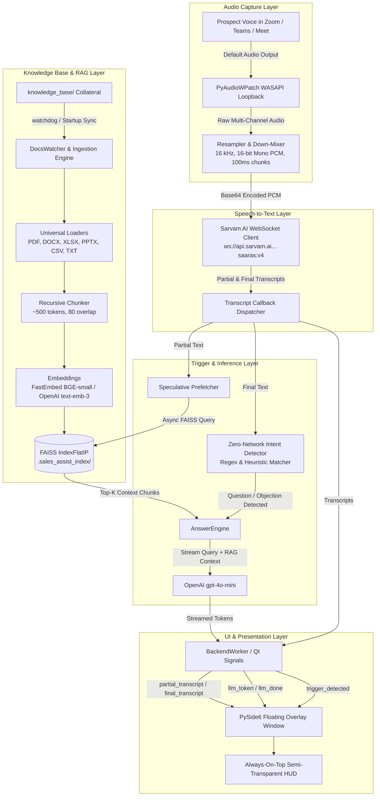
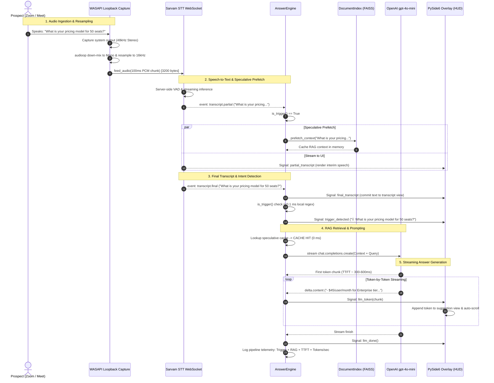

# Sales Assist — End-to-End Architecture & Data Flow Guide

> **Document Name:** `Supporting_document.md`  
> **Target Project:** Sales Assist AI Co-Pilot (`sales_assist`)  
> **Environment:** Windows (x64), Python 3.10+, WASAPI, FAISS, PySide6, Sarvam AI, OpenAI

---

## 1. Executive Summary & Purpose

**Sales Assist** is a real-time, bot-free desktop co-pilot application for sales professionals conducting meetings on Zoom, Microsoft Teams, or Google Meet. 

Unlike traditional meeting bots that join as visible participants and can cause friction with prospects, Sales Assist operates client-side on Windows using **WASAPI loopback audio capture**. It captures what the prospect says through the system audio output, streams the speech to **Sarvam AI STT** for sub-second transcription, identifies questions, objections, or commercial signals, performs vector search (RAG) against local company collateral via **FAISS**, and streams 2–3 bullet-point answers directly onto a **transparent, always-on-top PySide6 HUD overlay** without stealing keyboard focus or interrupting the call.

---

## 2. High-Level Architecture Diagram



---

## 3. Core Components Breakdown

The repository is modularized into distinct functional packages under [`sales_assist/`](file:///c:/Users/mangesh.bondre/Desktop/Sales_assistant_Assistant/sales_assist):

```
sales_assist/
├── audio/
│   └── loopback.py          # WASAPI loopback capture & PCM resampling
├── stt/
│   ├── base.py              # Abstract STT provider & transcript dataclasses
│   └── sarvam.py            # Sarvam AI real-time WebSocket client
├── docs/
│   ├── loaders.py           # Multi-format document parser (PDF, DOCX, XLSX, etc.)
│   ├── chunker.py           # Paragraph & sentence boundary text chunker
│   ├── index.py             # Persistent FAISS vector database & embedding manager
│   └── watcher.py           # Watchdog filesystem observer with debounced auto-sync
├── llm/
│   ├── answer.py            # Zero-network trigger classifier, speculative prefetch, LLM streaming
│   └── prompts.py           # Strict system prompts for live sales guidance
├── ui/
│   ├── overlay.py           # Frameless, translucent PySide6 HUD overlay
│   ├── worker.py            # Qt QObject thread bridge with custom Signals
│   └── settings.py          # Modal dialog for API keys and opacity slider
├── config.py                # Centralized .env loader and validation
├── ingest.py                # CLI runner for offline document ingestion & testing
├── app.py                   # Stage 3 console-based runner with latency telemetry
├── gui.py                   # Alternative CustomTkinter desktop interface
└── main.py                  # Primary production PySide6 application entry point
```

### 3.1. Audio Capture Engine ([`sales_assist/audio/loopback.py`](file:///c:/Users/mangesh.bondre/Desktop/Sales_assistant_Assistant/sales_assist/audio/loopback.py))
- **Underlying Technology:** `PyAudioWPatch` (Windows WASAPI loopback driver).
- **Core Class:** `LoopbackCapture`.
- **Functionality:**
  - Queries the Windows audio engine to discover the default playback device's WASAPI loopback device (`_resolve_device`).
  - Reads audio at native device rates (typically 44.1 kHz or 48 kHz stereo 16-bit).
  - Down-mixes multi-channel audio to mono using `audioop.tomono`.
  - Resamples to **16,000 Hz, 16-bit PCM** mono using `audioop.ratecv` maintaining continuous filter state (`resample_state`).
  - Produces 100 ms audio chunks (1,600 frames = 3,200 bytes per chunk) and invokes `callback(raw_pcm)`.
  - Runs in a background daemon thread (`loopback-capture`) to avoid blocking the UI or main thread.

### 3.2. Speech-to-Text (STT) Subsystem ([`sales_assist/stt/`](file:///c:/Users/mangesh.bondre/Desktop/Sales_assistant_Assistant/sales_assist/stt))
- **Base Interface ([`base.py`](file:///c:/Users/mangesh.bondre/Desktop/Sales_assistant_Assistant/sales_assist/stt/base.py)):**
  - Defines `STTProvider` with abstract methods: `start()`, `stop()`, and `feed_audio(pcm16_bytes: bytes)`.
  - Protocol events:
    - `PartialTranscript(text: str, utterance_id: str)`: Real-time interim hypothesis while the user speaks.
    - `FinalTranscript(text: str, utterance_id: str)`: Committed text after Voice Activity Detection (VAD) marks the end of an utterance.
- **Sarvam Provider ([`sarvam.py`](file:///c:/Users/mangesh.bondre/Desktop/Sales_assistant_Assistant/sales_assist/stt/sarvam.py)):**
  - Connects to `wss://api.sarvam.ai/speech-to-text-realtime/ws?language_code=auto&model=saaras:v4` via `websocket-client`.
  - Encodes incoming 16 kHz PCM chunks as Base64 strings inside JSON messages:
    ```json
    {"event": "audio_input", "audio": "<base64_encoded_pcm>"}
    ```
  - Receives WebSocket messages from Sarvam:
    - `transcript.partial`: Interim live speech.
    - `transcript.final`: Committed phrase; triggers automatic utterance ID rotation (`new_utterance_id`).
    - `speech_start` & `speech_end`: Server-side VAD state markers.
  - Features self-healing auto-reconnection loop: if the socket drops, it reconnects automatically within 2 seconds.

### 3.3. Document Ingestion & RAG Subsystem ([`sales_assist/docs/`](file:///c:/Users/mangesh.bondre/Desktop/Sales_assistant_Assistant/sales_assist/docs))
- **Universal Loaders ([`loaders.py`](file:///c:/Users/mangesh.bondre/Desktop/Sales_assistant_Assistant/sales_assist/docs/loaders.py)):**
  - Built with a fail-safe architecture: never crashes on corrupted files, always logs and skips gracefully.
  - Supports:
    - **PDF:** PyMuPDF (`fitz`), with OCR fallback using `pytesseract` and Pillow for image-only scans.
    - **DOCX / DOC:** `python-docx` for paragraphs and tables; LibreOffice headless CLI fallback for legacy `.doc`.
    - **XLSX / XLS:** `openpyxl` sheet row extraction.
    - **PPTX:** `python-pptx` slide text and table extraction.
    - **CSV / TXT / MD / JSON / HTML:** Built-in standard parsers with encoding fallbacks (`utf-8`, `utf-8-sig`, `latin-1`, `charset_normalizer`).
- **Semantic Chunker ([`chunker.py`](file:///c:/Users/mangesh.bondre/Desktop/Sales_assistant_Assistant/sales_assist/docs/chunker.py)):**
  - Splits document text into structured chunks of target ~500 tokens with 80 tokens overlap.
  - Hierarchy: Paragraph boundaries (`\n\n`) $\rightarrow$ Sentence boundaries (`[.!?।]\s+`) $\rightarrow$ Character slicing.
  - Preserves source metadata: filename, page number, and chunk index.
- **Vector Database Index ([`index.py`](file:///c:/Users/mangesh.bondre/Desktop/Sales_assistant_Assistant/sales_assist/docs/index.py)):**
  - Uses `faiss.IndexFlatIP` (Inner Product on L2-normalized vectors = exact cosine similarity).
  - Supports dual embedding backends:
    - **Local FastEmbed (`BAAI/bge-small-en-v1.5`):** 384 dimensions, running locally on CPU with zero network latency. Includes an instant startup warmup pass (`_warmup_local_model`).
    - **OpenAI (`text-embedding-3-small`):** 1536 dimensions.
  - Incremental disk persistence inside `.sales_assist_index/`:
    - `faiss.index`: Raw vector embeddings.
    - `metadata.json`: Text content, source filename, page, and chunk index.
    - `file_hashes.json`: SHA-256 hashes of indexed files. Files unchanged on disk are skipped; changed files are updated; deleted files have their vectors purged from the index.
  - Query caching: LRU cache for normalized queries to eliminate redundant vector computations.
- **Directory Watcher ([`watcher.py`](file:///c:/Users/mangesh.bondre/Desktop/Sales_assistant_Assistant/sales_assist/docs/watcher.py)):**
  - Leverages Python's `watchdog` to monitor the `knowledge_base/` folder.
  - Debounced at 2.0 seconds: batches rapid file writes (e.g., dropping 10 PDFs at once) into a single atomic incremental re-indexing job.

### 3.4. Answer Engine & Intent Triggering ([`sales_assist/llm/answer.py`](file:///c:/Users/mangesh.bondre/Desktop/Sales_assistant_Assistant/sales_assist/llm/answer.py))
- **Zero-Network Intent Detection (`is_trigger`):**
  - Replaces slow LLM intent classification (which wastes 800+ ms) with a sub-millisecond local regex analyzer (< 0.05 ms execution time).
  - Filters out conversational filler (`"ok"`, `"yeah"`, `"cool"`, `"sounds good"`).
  - Catches interrogatives (`what`, `how`, `why`, `could you`, `can we`, `?`).
  - Catches commercial intent keywords (`pricing`, `cost`, `discount`, `tier`, `contract`, `seats`, `license`, `roi`).
  - Catches technical/objection intent keywords (`integration`, `sla`, `uptime`, `soc2`, `gdpr`, `security`, `competitor`, `versus`, `limitations`).
- **Speculative RAG Prefetching (`prefetch_context`):**
  - Runs in the background as soon as a `PartialTranscript` exhibits question or commercial keywords.
  - Pre-queries FAISS and stores the context in memory (`_speculative_context`).
  - When the final transcript arrives, `generate_answer` gets a **Cache HIT**, reducing RAG retrieval latency to **0.0 ms**.
- **Streaming Generation (`generate_answer`):**
  - Assembles prompt with strict guidelines from [`prompts.py`](file:///c:/Users/mangesh.bondre/Desktop/Sales_assistant_Assistant/sales_assist/llm/prompts.py):
    - Answer based **ONLY** on the provided Context.
    - 2–3 concise bullet points (max ~15 words each).
    - If not in docs, output exactly: *"Not in docs, suggest following up."*
    - One short closing follow-up question.
  - Calls OpenAI `gpt-4o-mini` with `temperature=0.1` and `max_tokens=150`.
  - Supports mid-stream cancellation via `cancel_current()`: if the prospect asks a new question while an answer is being generated, the ongoing stream is halted immediately.

### 3.5. User Interface (UI) Layer ([`sales_assist/ui/`](file:///c:/Users/mangesh.bondre/Desktop/Sales_assistant_Assistant/sales_assist/ui))
- **`OverlayWindow` ([`overlay.py`](file:///c:/Users/mangesh.bondre/Desktop/Sales_assistant_Assistant/sales_assist/ui/overlay.py)):**
  - Implemented in **PySide6 (Qt6)**.
  - Window flags: `WindowStaysOnTopHint | FramelessWindowHint | Tool`.
  - Window attributes: `WA_ShowWithoutActivating` (prevents stealing active focus from Zoom/Teams) and `WA_TranslucentBackground`.
  - UI sections:
    - **Draggable Header:** Allows the user to reposition the overlay anywhere on screen.
    - **Controls:** "Hide Transcript" and "Copy Transcript" buttons.
    - **Live Transcript Box:** Displays committed utterances with a fade effect on older text, plus italic interim partial speech.
    - **Trigger Banner:** Highlights the detected question/objection in bold yellow.
    - **Suggestion View:** Live token-by-token streaming display of the AI response.
    - **Throttled Repainting:** Flushes interim partial updates at 30 FPS (33 ms QTimer) to prevent GUI freezes during rapid speech.
- **`BackendWorker` ([`worker.py`](file:///c:/Users/mangesh.bondre/Desktop/Sales_assistant_Assistant/sales_assist/ui/worker.py)):**
  - QObject worker that decouples background audio/STT/LLM threads from the Qt main thread using Qt Signals:
    - `partial_transcript(uid, text)`
    - `final_transcript(uid, text)`
    - `trigger_detected(text)`
    - `llm_token(token)`
    - `llm_done()`
    - `error_occurred(err_msg)`
- **`SettingsDialog` ([`settings.py`](file:///c:/Users/mangesh.bondre/Desktop/Sales_assistant_Assistant/sales_assist/ui/settings.py)):**
  - In-app configuration modal allowing live editing of API keys and real-time adjustment of overlay transparency (20% – 100%).

---

## 4. End-to-End Data Flow (Step-by-Step)

Here is the exact progression of data through the system during a live sales call:



### Detailed Phase Walkthrough:

#### Phase 1: Startup & Ingestion Sync
1. User executes [`sales_assist/main.py`](file:///c:/Users/mangesh.bondre/Desktop/Sales_assistant_Assistant/sales_assist/main.py) or `Run_Sales_Assist.bat`.
2. `DocumentIndex` initializes from disk (`.sales_assist_index/`). If using local embeddings, `BAAI/bge-small-en-v1.5` is loaded and warmed up with a dummy vector pass.
3. `DocsWatcher` starts: it performs an initial diff of `knowledge_base/` using SHA-256 hashes, indexes any new documents, and schedules a watchdog file system observer.
4. The `OverlayWindow` is launched (translucent, frameless, stays on top).
5. `BackendWorker` validates configuration keys in [`.env`](file:///c:/Users/mangesh.bondre/Desktop/Sales_assistant_Assistant/sales_assist/config.py) and launches the audio capture and STT WebSocket connections.

#### Phase 2: Live Loopback Capture & Normalization
1. PyAudioWPatch hooks into the Windows WASAPI default loopback device.
2. In-flight audio played through speakers or headphones is captured.
3. Chunks are converted from native multi-channel/sample rates into **16 kHz, 16-bit Mono PCM** chunks of 100 ms (1,600 frames).
4. Raw bytes are handed off to the STT provider.

#### Phase 3: Real-Time STT & Partial Speculation
1. `SarvamSTTProvider` Base64-encodes the PCM frames and dispatches them over the WebSocket.
2. Sarvam's `saaras:v4` returns `transcript.partial` events.
3. `OverlayWindow` renders these interim words in italics at 30 FPS.
4. Simultaneously, if `SPECULATIVE_PREFETCH` is enabled and the interim phrase triggers intent regex, `prefetch_context()` runs in a background thread to pre-load relevant knowledge chunks into an in-memory cache.

#### Phase 4: Intent Triggering
1. When the prospect pauses speaking, Sarvam VAD fires a `transcript.final` event.
2. The transcript is logged to history and rendered permanently in the UI.
3. `AnswerEngine.is_trigger(final_text)` performs zero-network regex matching in < 0.1 ms.
4. If a question, objection, pricing inquiry, or technical requirement is identified, any previous LLM generation is cancelled, and an answer thread is spawned.

#### Phase 5: RAG Context Retrieval
1. `AnswerEngine` checks the speculative prefetch cache. If matched, retrieval latency is **0 ms**.
2. If missed (e.g. abrupt short question), it queries `DocumentIndex.search(query, top_k=3)`:
   - Encodes query to vector (using local FastEmbed or OpenAI embeddings).
   - FAISS executes an inner-product search across the indexed document chunks.
   - Extracts top 3 text chunks and formats them as context with source citations.

#### Phase 6: Streaming Answer Inference
1. The engine constructs a prompt combining `ANSWER_SYSTEM_PROMPT`, the retrieved RAG context, and the prospect's query.
2. Calls OpenAI `gpt-4o-mini` with `stream=True`.
3. Tokens stream directly from OpenAI to `worker.llm_token`, which emits to `OverlayWindow.on_llm_token`.
4. The salesperson reads 2–3 succinct bullet points in real time on their screen.

---

## 5. System Latency Telemetry Breakdown

The application features built-in terminal latency telemetry in [`sales_assist/llm/answer.py`](file:///c:/Users/mangesh.bondre/Desktop/Sales_assistant_Assistant/sales_assist/llm/answer.py) tracking each step of the pipeline:

| Pipeline Step | Mechanism | Typical Latency | Notes |
|---|---|---|---|
| **Step 1: Trigger Detection** | Local compiled regex & heuristics | **0.002 – 0.05 ms** | Sub-millisecond, zero network overhead |
| **Step 2: RAG Retrieval** | Speculative prefetch cache | **0.0 ms (Cache HIT)** | 5 – 25 ms on cache MISS via local FAISS |
| **Step 3: Time-to-First-Token (TTFT)** | OpenAI `gpt-4o-mini` API streaming | **300 – 650 ms** | Fast initial response for immediate reading |
| **Step 4: Stream Completion** | Token generation speed | **45 – 90 tokens/sec** | Total answer generated in ~1.2 – 1.8 seconds |
| **Pipeline Total** | Trigger $\rightarrow$ Completed Answer | **1.5 – 2.4 seconds** | Salesperson reads answer before prospect finishes thinking |

---

## 6. Supported File Formats & Knowledge Base Loaders

| File Extension | Parsing Engine | Fallback Strategy |
|---|---|---|
| `.pdf` | `PyMuPDF` (`fitz`) | `pytesseract` + `Pillow` OCR for scanned pages (< 50 chars) |
| `.docx` | `python-docx` (paragraphs + tables) | Plain text extract |
| `.doc` | LibreOffice Headless CLI (`soffice`) | Converted to `.docx` then parsed via `python-docx` |
| `.xlsx`, `.xls` | `openpyxl` | Formatted as pipe-delimited text tables per sheet |
| `.pptx` | `python-pptx` | Extracts text boxes, shapes, and tables per slide |
| `.txt`, `.md` | Python standard library | Multi-encoding (`utf-8`, `utf-8-sig`, `latin-1`, `charset_normalizer`) |
| `.csv` | Python `csv` reader | Formatted as pipe-delimited markdown-style tables |
| `.json` | Python `json` standard module | Pretty-printed indented JSON dump |
| `.html`, `.htm`| `html.parser.HTMLParser` | Strips script/style tags, preserves clean text |

---

## 7. Configuration Reference (`.env`)

Defined in [`sales_assist/config.py`](file:///c:/Users/mangesh.bondre/Desktop/Sales_assistant_Assistant/sales_assist/config.py):

| Variable | Default Value | Description |
|---|---|---|
| `SARVAM_API_KEY` | *(Required)* | API key for Sarvam AI Speech-to-Text WebSocket |
| `OPENAI_API_KEY` | *(Required)* | API key for OpenAI (`gpt-4o-mini` and embeddings) |
| `STT_LANGUAGE` | `auto` | Primary spoken language for Sarvam STT |
| `STT_MODEL` | `saaras:v4` | Sarvam real-time STT model identifier |
| `OPENAI_MODEL` | `gpt-4o-mini` | Chat model used for generating answer bullet points |
| `LLM_MAX_TOKENS` | `150` | Output token cap (ensures brief 2-3 bullets) |
| `SPECULATIVE_PREFETCH` | `true` | Enables background FAISS search during partial speech |
| `EMBEDDING_PROVIDER` | `local` | `local` (FastEmbed CPU) or `openai` (API) |
| `LOCAL_EMBEDDING_MODEL`| `BAAI/bge-small-en-v1.5` | Local embedding model name (dim=384) |
| `LOCAL_MODELS_DIR` | `models` | Local directory for caching embedding model weights |
| `DOCS_FOLDER` | `knowledge_base` | Directory monitored by the real-time file watcher |

---

## 8. Build & Packaging Pipeline ([`build.py`](file:///c:/Users/mangesh.bondre/Desktop/Sales_assistant_Assistant/build.py))

To distribute the app without requiring clients to install Python, PyTorch, or system dependencies, a PyInstaller packaging script is provided:

- **Command:** `python build.py`
- **Options:**
  - Default: `--console` mode (retains the terminal console so live latency telemetry is visible).
  - Production Silent: `python build.py --windowed` (suppresses the console window completely).
- **Output:** Creates `dist/SalesAssist/` containing:
  - `SalesAssist.exe`: Compiled standalone binary.
  - Bundled ONNX runtime & FastEmbed models.
  - Automatically copied `.env`, `knowledge_base/`, and `models/` folders.

---

## 9. Summary Comparison of UI Modes

The repository provides three separate entry points suited for different environments:

1. **`python -m sales_assist.main` (Recommended)**:
   - Full PySide6 frameless HUD overlay window.
   - Draggable, semi-transparent, stays on top, never steals focus.
   - Settings dialog for live key/opacity adjustments.
2. **`python -m sales_assist.gui` (`Run_Sales_Assist.bat`)**:
   - CustomTkinter dark-mode split-pane window (Transcript on left, AI co-pilot on right).
   - Ideal for dual-monitor setups where the copilot has its own dedicated screen.
3. **`python -m sales_assist.app`**:
   - Console-only Stage 3 test runner.
   - Direct standard output streaming with terminal latency telemetry prints.
