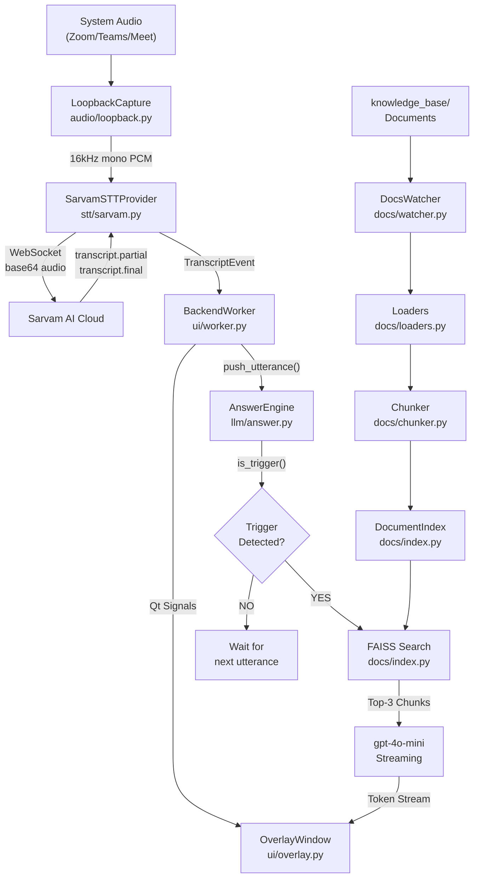

# 📋 Sales Assist — Comprehensive Code Review Document

> **Author:** Mangesh Bondre  
> **Date:** October 7, 2026  
> **Purpose:** Code review walkthrough of the entire Sales Assist codebase. This document explains every file, every class, every function, and every design decision in the project for senior review.

---

## Table of Contents

1. [Executive Summary](#1-executive-summary)
2. [High-Level Architecture](#2-high-level-architecture)
3. [Root-Level Files](#3-root-level-files)
   - [README.md](#31-readmemd)
   - [Run_Sales_Assist.bat](#32-run_sales_assistbat)
   - [build.py](#33-buildpy)
4. [Configuration Layer](#4-configuration-layer---sales_assistconfigpy)
5. [Audio Capture Module](#5-audio-capture-module---sales_assistaudio)
6. [Speech-to-Text Module](#6-speech-to-text-module---sales_assiststt)
7. [Document Processing Module](#7-document-processing-module---sales_assistdocs)
8. [LLM Processing Module](#8-llm-processing-module---sales_assistllm)
9. [UI Module — PySide6 Overlay](#9-ui-module--pyside6-overlay---sales_assistui)
10. [GUI Module — CustomTkinter](#10-gui-module--customtkinter---sales_assistguipy)
11. [Application Entry Points](#11-application-entry-points)
12. [Test Suite](#12-test-suite)
13. [Data & Index Files](#13-data--index-files)
14. [Dependencies Analysis](#14-dependencies-analysis)
15. [Design Patterns Used](#15-design-patterns-used)
16. [Thread Safety & Concurrency Model](#16-thread-safety--concurrency-model)
17. [Potential Improvements](#17-potential-improvements--observations)

---

## 1. Executive Summary

**Sales Assist** is a real-time AI copilot for salespeople. During a live sales call (Zoom, Teams, etc.), it:

1. **Captures** the prospect's audio via Windows WASAPI loopback (no microphone needed).
2. **Transcribes** it in real-time using Sarvam AI's WebSocket STT API.
3. **Detects** questions, objections, and buying signals (heuristics + LLM classifier).
4. **Retrieves** relevant context from a local FAISS vector database (company documents).
5. **Streams** a concise 2–3 bullet-point answer from `gpt-4o-mini` onto a floating overlay window.

The project was developed in **5 stages**, each building on the previous:

| Stage | Scope | Key Files |
|-------|-------|-----------|
| **1** | Audio Capture + STT | `audio/loopback.py`, `stt/base.py`, `stt/sarvam.py` |
| **2** | Document Ingestion + FAISS Index | `docs/loaders.py`, `docs/chunker.py`, `docs/index.py` |
| **3** | LLM Trigger Detection + RAG Answers | `llm/answer.py`, `llm/prompts.py`, `app.py` |
| **4** | PySide6 Floating Overlay UI | `ui/overlay.py`, `ui/settings.py`, `ui/worker.py`, `main.py` |
| **5** | Build, Logging, Auto-Watcher | `build.py`, `docs/watcher.py`, `Run_Sales_Assist.bat` |

**Total Lines of Code (excluding tests):** ~2,200 lines across 18 Python files.

---

## 2. High-Level Architecture



---

## 3. Root-Level Files

### 3.1 `README.md`
- **Purpose:** Project documentation (overview, setup instructions, architecture).
- **Lines:** ~280 lines.
- **Notes:** Comprehensive documentation covering all 5 stages.

### 3.2 `Run_Sales_Assist.bat`

**File:** [`Run_Sales_Assist.bat`](file:///c:/Users/mangesh.bondre/Desktop/Sales_assistant_Assistant/Run_Sales_Assist.bat)  
**Lines:** 6  
**Purpose:** One-click Windows launcher.

```batch
@echo off
echo Starting Sales Assist Co-Pilot...
call .\.venv\Scripts\activate
start pythonw -m sales_assist.gui
exit
```

**What it does:**
1. Suppresses command echoing (`@echo off`).
2. Prints a startup message.
3. Activates the Python virtual environment.
4. Launches the CustomTkinter GUI silently using `pythonw` (no console window).
5. Exits the batch window immediately.

**Design Decision:** Uses `pythonw` instead of `python` to prevent a visible console window — the user only sees the GUI.

---

### 3.3 `build.py`

**File:** [`build.py`](file:///c:/Users/mangesh.bondre/Desktop/Sales_assistant_Assistant/build.py)  
**Lines:** 38  
**Purpose:** PyInstaller build script to create a standalone `.exe`.

#### Function: `main()`
| Aspect | Detail |
|--------|--------|
| **Flags** | `--noconfirm` (overwrite without asking), `--windowed` (no console), `--onedir` (folder-based output for faster startup) |
| **Entry point** | `sales_assist/main.py` |
| **Output** | `dist/SalesAssist/SalesAssist.exe` |

**How it works:** Invokes PyInstaller via `subprocess.run()` using `sys.executable` to ensure it uses the same Python interpreter. Exits with the PyInstaller return code on failure.

---

## 4. Configuration Layer — `sales_assist/config.py`

**File:** [`config.py`](file:///c:/Users/mangesh.bondre/Desktop/Sales_assistant_Assistant/sales_assist/config.py)  
**Lines:** 68  
**Purpose:** Centralized configuration loader. Single source of truth for all settings.

### How It Works

1. Determines the project root as the parent of `config.py` itself.
2. Loads `.env` using `python-dotenv`. Prints a warning to stderr if `.env` is missing.
3. Exposes all settings as **module-level constants** (importable from anywhere).

### Constants Defined

| Constant | Type | Default | Description |
|----------|------|---------|-------------|
| `SARVAM_API_KEY` | `str` | `""` | Sarvam AI API key |
| `OPENAI_API_KEY` | `str` | `""` | OpenAI API key |
| `STT_LANGUAGE` | `str` | `"auto"` | STT language code |
| `STT_MODEL` | `str` | `"saaras:v4"` | Sarvam STT model |
| `SARVAM_WS_URL` | `str` | `"wss://api.sarvam.ai/..."` | Sarvam WebSocket endpoint |
| `AUDIO_SAMPLE_RATE` | `int` | `16000` | Target sample rate (16 kHz) |
| `AUDIO_CHANNELS` | `int` | `1` | Mono |
| `AUDIO_SAMPLE_WIDTH` | `int` | `2` | 16-bit PCM = 2 bytes |
| `AUDIO_CHUNK_DURATION_MS` | `int` | `100` | Chunk every 100ms |
| `AUDIO_CHUNK_FRAMES` | `int` | `1600` | Computed: 16000 × 100 / 1000 |
| `DOCS_FOLDER` | `str` | `"knowledge_base"` | Auto-watch folder |

### Function: `validate() → list[str]`

Returns a list of missing required config values. Currently only checks for `SARVAM_API_KEY`. The OpenAI key is validated lazily (at first use).

---

## 5. Audio Capture Module — `sales_assist/audio/`

### 5.1 `audio/__init__.py`
**Lines:** 2. Package marker only.

### 5.2 `audio/loopback.py`

**File:** [`loopback.py`](file:///c:/Users/mangesh.bondre/Desktop/Sales_assistant_Assistant/sales_assist/audio/loopback.py)  
**Lines:** 203  
**Purpose:** Captures system audio via WASAPI loopback and delivers 16 kHz mono PCM chunks.

#### Type Alias
```python
AudioCallback = Callable[[bytes], None]
```
Called with raw 16 kHz mono 16-bit PCM bytes.

#### Class: `LoopbackCapture`

| Attribute | Type | Description |
|-----------|------|-------------|
| `_callback` | `AudioCallback` | Function to receive PCM chunks |
| `_device_index` | `Optional[int]` | Specific WASAPI loopback device; `None` = default |
| `_pa` | `Optional[pyaudio.PyAudio]` | PyAudio instance |
| `_stream` | `Optional[pyaudio.Stream]` | Active audio stream |
| `_thread` | `Optional[threading.Thread]` | Background capture thread |
| `_stop_event` | `threading.Event` | Signals the capture loop to exit |

#### Methods

| Method | Signature | Description |
|--------|-----------|-------------|
| `__init__` | `(callback, device_index=None)` | Stores callback, initializes state |
| `start()` | `→ None` | Opens loopback stream, starts background capture thread |
| `stop()` | `→ None` | Signals stop, joins thread, closes stream & PyAudio |
| `is_running` | `@property → bool` | Whether the capture thread is alive |
| `_resolve_device()` | `→ dict` | Finds the WASAPI loopback device (explicit index or default) |
| `list_loopback_devices()` | `@staticmethod → list[dict]` | Lists all available WASAPI loopback input devices |
| `_capture_loop(native_rate, native_channels, chunk_frames)` | `→ None` | Main capture loop: reads audio, down-mixes to mono via `audioop.tomono()`, resamples to 16 kHz via `audioop.ratecv()`, delivers to callback |

#### Audio Processing Pipeline (inside `_capture_loop`)
```
Raw WASAPI audio (e.g., 48kHz stereo)
    │
    ▼ audioop.tomono() — weighted average of channels
    │
    ▼ audioop.ratecv() — streaming resampling to 16 kHz
    │
    ▼ callback(pcm16_bytes) — delivered to SarvamSTTProvider.feed_audio()
```

**Key Design Decisions:**
- Uses `audioop` (standard library) for resampling instead of a heavy DSP library — keeps the dependency footprint minimal.
- `exception_on_overflow=False` on `stream.read()` prevents crashes when the system is under load.
- `resample_state` is maintained across loop iterations for seamless streaming resampling.

---

## 6. Speech-to-Text Module — `sales_assist/stt/`

### 6.1 `stt/__init__.py`
**Lines:** 2. Package marker only.

### 6.2 `stt/base.py`

**File:** [`base.py`](file:///c:/Users/mangesh.bondre/Desktop/Sales_assistant_Assistant/sales_assist/stt/base.py)  
**Lines:** 82  
**Purpose:** Abstract STT provider interface and event data classes.

#### Enum: `TranscriptType`
```python
class TranscriptType(str, Enum):
    PARTIAL = "partial"
    FINAL = "final"
```

#### Dataclass: `PartialTranscript` (frozen)
| Field | Type | Description |
|-------|------|-------------|
| `text` | `str` | Interim transcription text |
| `utterance_id` | `str` | Groups partials belonging to one utterance |
| `type` | `TranscriptType` | Always `PARTIAL` (auto-set, not in `__init__`) |

#### Dataclass: `FinalTranscript` (frozen)
| Field | Type | Description |
|-------|------|-------------|
| `text` | `str` | Committed final transcription text |
| `utterance_id` | `str` | Matches the preceding partials |
| `type` | `TranscriptType` | Always `FINAL` (auto-set) |

**Why frozen?** Immutability guarantees thread safety — events are passed across threads without risk of mutation.

#### Type Aliases
```python
TranscriptEvent = Union[PartialTranscript, FinalTranscript]
TranscriptCallback = Callable[[TranscriptEvent], None]
```

#### Abstract Class: `STTProvider`
| Method | Description |
|--------|-------------|
| `__init__(callback)` | Stores the callback function |
| `_emit(event)` | Delivers a transcript event to the callback |
| `new_utterance_id()` | `@staticmethod` — generates a unique 12-char hex UUID |
| `start()` | **Abstract** — prepare the provider |
| `stop()` | **Abstract** — tear down the provider |
| `feed_audio(pcm16_bytes)` | **Abstract** — accept a chunk of 16 kHz mono PCM |

**Design Pattern:** Template Method — the base class defines the callback wiring; subclasses implement the transport.

---

### 6.3 `stt/sarvam.py`

**File:** [`sarvam.py`](file:///c:/Users/mangesh.bondre/Desktop/Sales_assistant_Assistant/sales_assist/stt/sarvam.py)  
**Lines:** 246  
**Purpose:** Sarvam AI real-time WebSocket STT implementation.

#### Class: `SarvamSTTProvider(STTProvider)`

| Attribute | Type | Description |
|-----------|------|-------------|
| `_language` | `str` | Language code (default: `auto`) |
| `_model` | `str` | STT model (default: `saaras:v4`) |
| `_ws` | `Optional[WebSocketApp]` | Active WebSocket connection |
| `_ws_thread` | `Optional[Thread]` | Thread running the WebSocket event loop |
| `_connected` | `threading.Event` | Signals when connection is established |
| `_stop_event` | `threading.Event` | Signals graceful shutdown |
| `_current_utterance_id` | `str` | Tracks the current utterance for grouping events |
| `_lock` | `threading.Lock` | Protects `_current_utterance_id` |

#### Methods

| Method | Description |
|--------|-------------|
| `start()` | Builds WebSocket URL with API key in header, creates `WebSocketApp`, starts the WS thread, waits up to 10s for connection |
| `stop()` | Sets stop event, closes WebSocket, joins thread |
| `feed_audio(pcm16_bytes)` | Base64-encodes PCM bytes, sends as `{"event": "audio_input", "audio": "..."}` JSON message |
| `_on_open(ws)` | Sets `_connected` event |
| `_on_message(ws, message)` | Parses JSON; handles `transcript.partial`, `transcript.final`, `speech_start`, `speech_end`, `error` events |
| `_on_error(ws, error)` | Logs WebSocket errors |
| `_on_close(ws, code, msg)` | Clears `_connected` event, logs close reason |
| `_run_ws()` | Main WebSocket event loop with **auto-reconnect** — if the socket closes unexpectedly, waits 2s and rebuilds the `WebSocketApp` |

#### Sarvam Protocol Events Handled

| Event | Action |
|-------|--------|
| `transcript.partial` | Emits `PartialTranscript` with current `utterance_id` |
| `transcript.final` | Emits `FinalTranscript`, rotates `utterance_id` |
| `speech_start` | Rotates `utterance_id` for the new utterance |
| `speech_end` | Logged only (debug) |
| `error` / `server_error` | Logged as error |

**Key Design Decisions:**
- **Auto-reconnect**: The `_run_ws()` loop rebuilds the WebSocketApp on disconnect, making the system resilient to transient network issues.
- **Connection timeout**: `start()` blocks up to 10 seconds via `_connected.wait(timeout=10.0)` — fails fast if the network or API key is bad.
- **Ping/pong**: `run_forever(ping_interval=20, ping_timeout=10)` keeps the connection alive.

---

## 7. Document Processing Module — `sales_assist/docs/`

### 7.1 `docs/__init__.py`
**Lines:** 2. Package marker for Stage 2.

### 7.2 `docs/loaders.py`

**File:** [`loaders.py`](file:///c:/Users/mangesh.bondre/Desktop/Sales_assistant_Assistant/sales_assist/docs/loaders.py)  
**Lines:** 397  
**Purpose:** Universal document loaders. Extracts text from 12+ file formats without crashing.

#### Data Classes

**`PageContent`** — a single page/section of extracted text:
| Field | Type | Default | Description |
|-------|------|---------|-------------|
| `text` | `str` | — | Extracted text content |
| `source` | `str` | — | Original filename |
| `page` | `int` | `0` | 0-based page/sheet/slide number |
| `metadata` | `dict` | `{}` | Additional metadata |

**`LoadResult`** — result of loading a single file:
| Field | Type | Default | Description |
|-------|------|---------|-------------|
| `source` | `str` | — | Filename |
| `pages` | `list[PageContent]` | `[]` | Extracted pages |
| `success` | `bool` | `True` | Whether loading succeeded |
| `error` | `Optional[str]` | `None` | Error message if failed |

#### Individual Loader Functions

| Function | Format | Library | Notable Features |
|----------|--------|---------|------------------|
| `_load_pdf(path)` | `.pdf` | PyMuPDF (`fitz`) | OCR fallback via `pytesseract` if page text < 50 chars |
| `_load_docx(path)` | `.docx` | `python-docx` | Extracts both paragraphs AND table text (pipe-delimited) |
| `_load_doc(path)` | `.doc` | LibreOffice headless | Converts `.doc` → `.docx` in a temp dir, then uses `_load_docx` |
| `_load_text(path)` | `.txt`, `.md` | stdlib | Tries UTF-8 → UTF-8-SIG → Latin-1 → `charset_normalizer` |
| `_load_csv_file(path)` | `.csv` | `csv` module | Converts rows to pipe-delimited text |
| `_load_json_file(path)` | `.json` | `json` module | Pretty-prints JSON with `indent=2` for better chunking |
| `_load_html(path)` | `.html`, `.htm` | `html.parser` | Custom `_HTMLTextExtractor` strips `<script>` and `<style>` tags |
| `_load_xlsx(path)` | `.xlsx`, `.xls` | `openpyxl` | One `PageContent` per sheet, includes sheet name header |
| `_load_pptx(path)` | `.pptx` | `python-pptx` | One `PageContent` per slide, extracts text frames + tables |

#### Helper Class: `_HTMLTextExtractor(HTMLParser)`
| Method | Description |
|--------|-------------|
| `handle_starttag(tag, attrs)` | Sets `_skip=True` for `<script>` and `<style>` |
| `handle_endtag(tag)` | Clears `_skip` for `</script>` and `</style>` |
| `handle_data(data)` | Appends non-empty text unless inside a skip tag |
| `get_text()` | Returns all collected text joined by newlines |

#### Dispatcher

```python
_LOADER_MAP: dict[str, callable] = {
    ".pdf": _load_pdf, ".docx": _load_docx, ".doc": _load_doc,
    ".txt": _load_text, ".md": _load_text, ".csv": _load_csv_file,
    ".json": _load_json_file, ".html": _load_html, ".htm": _load_html,
    ".xlsx": _load_xlsx, ".xls": _load_xlsx, ".pptx": _load_pptx,
}
```

#### Public Functions

| Function | Signature | Description |
|----------|-----------|-------------|
| `load_file(path)` | `→ LoadResult` | Dispatches to the correct loader by extension. Falls back to text decode for unknown types. **Never raises** — catches all exceptions. |
| `load_folder(folder)` | `→ list[LoadResult]` | Recursively walks the folder, skips hidden files/dirs (starting with `.`), calls `load_file()` for each. |

**Design Principle:** **Defensive programming** — every loader is wrapped in try/except. A single corrupt file never takes down the entire ingestion pipeline.

---

### 7.3 `docs/chunker.py`

**File:** [`chunker.py`](file:///c:/Users/mangesh.bondre/Desktop/Sales_assistant_Assistant/sales_assist/docs/chunker.py)  
**Lines:** 207  
**Purpose:** Splits extracted page text into overlapping chunks suitable for embedding.

#### Constant
```python
CHARS_PER_TOKEN = 4  # Approximate for English text
```

#### Dataclass: `Chunk` (frozen)
| Field | Type | Description |
|-------|------|-------------|
| `text` | `str` | Chunk text content |
| `source` | `str` | Original filename |
| `page` | `int` | 0-based page number |
| `chunk_index` | `int` | Sequential index within the source file |
| `metadata` | `dict` | Inherited from `PageContent` |

**Property:** `estimated_tokens → int` — `len(text) // CHARS_PER_TOKEN`

#### Functions

| Function | Signature | Description |
|----------|-----------|-------------|
| `chunk_pages(pages, max_tokens=500, overlap_tokens=80)` | `→ list[Chunk]` | Main chunking function — splits text using a 3-tier strategy |
| `_est_tokens(text)` | `→ int` | Estimates token count from character length |
| `_split_long_text(text, max_chars, overlap_chars, source, page, start_idx, metadata)` | `→ list[Chunk]` | Handles text too long for a single chunk — tries sentence boundaries, falls back to hard character split |

#### Chunking Strategy (3 tiers)
1. **Paragraph boundaries** (`\n\n`) — try to keep whole paragraphs together.
2. **Sentence boundaries** (`(?<=[.!?।])\s+`) — split within a paragraph if it's too long. Note: supports Hindi sentence terminator (`।`).
3. **Hard character split** — last resort for text with no natural boundaries (e.g., a giant URL or code block).

**Overlap:** After each chunk flush, the last `overlap_chars` characters from the previous chunk are prepended to the next chunk's buffer. This ensures context continuity for embedding search.

---

### 7.4 `docs/index.py`

**File:** [`index.py`](file:///c:/Users/mangesh.bondre/Desktop/Sales_assistant_Assistant/sales_assist/docs/index.py)  
**Lines:** 447  
**Purpose:** Persistent FAISS vector index with OpenAI embeddings. The core of the RAG system.

#### Constants
| Constant | Value | Description |
|----------|-------|-------------|
| `EMBEDDING_MODEL` | `"text-embedding-3-small"` | OpenAI embedding model |
| `EMBEDDING_DIM` | `1536` | Vector dimension |
| `INDEX_DIR_NAME` | `".sales_assist_index"` | Default persistence directory |
| `INDEX_FILE` | `"faiss.index"` | Binary FAISS index file |
| `META_FILE` | `"metadata.json"` | Chunk metadata JSON |
| `HASHES_FILE` | `"file_hashes.json"` | File hash tracking JSON |
| `BATCH_SIZE` | `64` | OpenAI embedding API batch limit |

#### Dataclass: `ChunkMeta`
| Field | Type | Description |
|-------|------|-------------|
| `text` | `str` | Original chunk text (stored for retrieval) |
| `source` | `str` | Source filename |
| `page` | `int` | Page number |
| `chunk_index` | `int` | Chunk index |

Methods: `to_dict()`, `from_dict(d)`.

#### Dataclass: `IngestionSummary`
Tracks what happened during ingestion:
| Field | Type | Description |
|-------|------|-------------|
| `indexed` | `list[str]` | Newly indexed files |
| `skipped` | `list[tuple[str, str]]` | Skipped files (filename, reason) |
| `failed` | `list[tuple[str, str]]` | Failed files (filename, error) |
| `updated` | `list[str]` | Re-indexed files (hash changed) |
| `removed` | `list[str]` | Removed files (deleted from disk) |
| `total_chunks` | `int` | Total chunks in the index |
| `elapsed_seconds` | `float` | Wall-clock time |

Method: `print_report()` — pretty-prints a colorful summary with emoji.

#### Class: `DocumentIndex`

| Attribute | Type | Description |
|-----------|------|-------------|
| `_persist_dir` | `Path` | Directory for persisted files |
| `_client` | `Optional[OpenAI]` | Lazy-initialized OpenAI client |
| `_index` | `Optional[faiss.IndexFlatIP]` | FAISS inner-product index |
| `_metadata` | `list[ChunkMeta]` | Parallel list of chunk metadata |
| `_file_hashes` | `dict[str, str]` | `{filename: sha256_hash}` |

#### Methods — Detailed Breakdown

| Method | Signature | Description |
|--------|-----------|-------------|
| `__init__(persist_dir=None)` | — | Creates persist dir, calls `_load_from_disk()` |
| `_get_client()` | `→ OpenAI` | Lazy init of OpenAI client. Raises if no API key. |
| `_load_from_disk()` | `→ None` | Loads `faiss.index` + `metadata.json` + `file_hashes.json` from disk. Creates empty index if files don't exist. |
| `_save_to_disk()` | `→ None` | Persists index, metadata, and hashes to disk. |
| `_file_hash(path)` | `@staticmethod → str` | SHA-256 hash of file contents (8KB blocks). |
| `_embed_texts(texts)` | `→ np.ndarray` | Embeds text list via OpenAI API in batches of 64. Returns L2-normalized float32 array for cosine similarity via inner product. |
| `_remove_by_source(source)` | `→ int` | Removes all vectors belonging to a source file. Rebuilds the entire index (since FAISS `IndexFlatIP` doesn't support deletion). Returns count removed. |
| `_add_chunks(chunks)` | `→ int` | Embeds and adds chunks to the FAISS index. Returns count added. |
| `ingest_folder(folder, max_tokens=500, overlap_tokens=80)` | `→ IngestionSummary` | **Core ingestion method.** Handles incremental updates: detects new/changed/deleted files via hash comparison. |
| `ingest_file(path, max_tokens=500, overlap_tokens=80)` | `→ IngestionSummary` | Single-file ingestion with hash checking. |
| `search(query, top_k=5)` | `→ list[tuple[ChunkMeta, float]]` | Embeds the query, searches FAISS, returns `(metadata, score)` tuples sorted by descending similarity. |
| `total_chunks` | `@property → int` | Number of vectors in the index. |
| `indexed_files` | `@property → list[str]` | List of all indexed filenames. |
| `clear()` | `→ None` | Wipes the entire index and persists the empty state. |

#### Incremental Ingestion Logic (`ingest_folder`)

```
1. Load all files from folder via load_folder()
2. Compute SHA-256 hash for each successfully loaded file
3. DETECT REMOVED: For each old hash not in current files → _remove_by_source()
4. For each loaded file:
   a. If hash matches stored hash → SKIP (unchanged)
   b. If hash differs from stored hash → _remove_by_source() + re-chunk + re-embed (UPDATE)
   c. If no stored hash → chunk + embed (NEW)
5. _save_to_disk()
```

**FAISS Index Type:** `IndexFlatIP` (inner product) with L2-normalized vectors — this is equivalent to cosine similarity but faster since it avoids the division step.

---

### 7.5 `docs/watcher.py`

**File:** [`watcher.py`](file:///c:/Users/mangesh.bondre/Desktop/Sales_assistant_Assistant/sales_assist/docs/watcher.py)  
**Lines:** 105  
**Purpose:** Watches the `knowledge_base/` directory for file changes and triggers auto-ingestion.

#### Class: `IngestionEventHandler(FileSystemEventHandler)`

| Attribute | Type | Description |
|-----------|------|-------------|
| `_index` | `DocumentIndex` | Reference to the FAISS index |
| `_folder` | `Path` | Watched folder path |
| `_debounce_sec` | `float` | Debounce delay (default: 2.0s) |
| `_timer` | `Optional[threading.Timer]` | Current debounce timer |
| `_lock` | `threading.Lock` | Protects timer access |

| Method | Description |
|--------|-------------|
| `_trigger_ingest()` | Calls `self._index.ingest_folder()`. Only prints report if something actually changed. |
| `_debounce()` | Cancels any pending timer, starts a new 2-second timer. This prevents rapid file saves from triggering multiple ingestions. |
| `on_modified(event)` | Calls `_debounce()` for file events |
| `on_created(event)` | Calls `_debounce()` for file events |
| `on_deleted(event)` | Calls `_debounce()` for file events |
| `on_moved(event)` | Calls `_debounce()` for file events |

#### Class: `DocsWatcher`

| Method | Description |
|--------|-------------|
| `__init__(index, folder)` | Stores references, initializes observer to None |
| `start()` | Creates folder if missing, performs **startup sync** (initial `ingest_folder`), then starts the `watchdog.Observer` for recursive monitoring |
| `stop()` | Stops and joins the observer thread |

**Design Decision:** Debouncing at 2 seconds prevents the "save-save-save" pattern (e.g., copying multiple files) from firing multiple expensive embedding API calls.

---

## 8. LLM Processing Module — `sales_assist/llm/`

### 8.1 `llm/__init__.py`
**Lines:** 2. Package marker for Stage 3.

### 8.2 `llm/prompts.py`

**File:** [`prompts.py`](file:///c:/Users/mangesh.bondre/Desktop/Sales_assistant_Assistant/sales_assist/llm/prompts.py)  
**Lines:** 38  
**Purpose:** System prompts for LLM classification and answer generation.

#### `ANSWER_SYSTEM_PROMPT`
Instructs the LLM to act as "Sales Assist", a real-time copilot:
- Answer ONLY from provided context (no hallucination)
- Output "Not in docs, suggest following up." if context lacks the answer
- Keep answers to 2–3 short bullet points (~15 words each)
- Optionally end with a follow-up question

#### `CLASSIFICATION_PROMPT`
Determines if an utterance requires a response:
- Looks for: Questions, objections, pricing/competitor mentions, buying signals
- Responds with only `"YES"` or `"NO"`
- Uses `.format(utterance=...)` for injection

---

### 8.3 `llm/answer.py`

**File:** [`answer.py`](file:///c:/Users/mangesh.bondre/Desktop/Sales_assistant_Assistant/sales_assist/llm/answer.py)  
**Lines:** 164  
**Purpose:** Coordinates trigger detection, FAISS retrieval, and streaming LLM answers.

#### Type Alias
```python
StreamCallback = Callable[[str], None]
```

#### Class: `AnswerEngine`

| Attribute | Type | Description |
|-----------|------|-------------|
| `_index` | `DocumentIndex` | FAISS index reference |
| `_client` | `Optional[OpenAI]` | Lazy-initialized OpenAI client |
| `_cancel_event` | `threading.Event` | Signals streaming cancellation |
| `_lock` | `threading.Lock` | Protects `_recent_utterances` |
| `_recent_utterances` | `list[str]` | Last 3 utterances for context enrichment |

#### Methods

| Method | Signature | Description |
|--------|-----------|-------------|
| `_get_client()` | `→ OpenAI` | Lazy init with API key validation |
| `push_utterance(text)` | `→ None` | Adds text to `_recent_utterances`, keeps max 3. Thread-safe via lock. |
| `is_trigger(utterance)` | `→ bool` | **Two-tier trigger detection** (see below) |
| `cancel_current()` | `→ None` | Sets `_cancel_event` to abort any running `generate_answer()` |
| `generate_answer(query, callback)` | `→ None` | Full RAG pipeline: clear cancel → build context from recent utterances → FAISS search (top-3) → construct prompt → stream `gpt-4o-mini` response → deliver tokens via callback. Blocks until done or cancelled. |

#### Trigger Detection Logic (`is_trigger`)

```
1. FAST LOCAL HEURISTICS:
   - If utterance < 3 words and no "?" → return False (filler: "ok", "yeah")
   - If utterance contains any trigger word → return True
     Trigger words: ?, what, how, why, who, when, where, price, cost,
     expensive, competitor, discount, budget, contract, security,
     integration, support

2. LLM FALLBACK (if no heuristic matched):
   - Call gpt-4o-mini with CLASSIFICATION_PROMPT
   - max_tokens=5, temperature=0.0 (deterministic)
   - Return True if response contains "YES"
```

**Why two tiers?** The local heuristics catch 80%+ of triggers instantly (no API call, no latency). The LLM fallback catches nuanced cases like "I'm not sure about the ROI" or "Tell me more about that."

#### RAG Answer Generation Flow (`generate_answer`)

```
1. Clear _cancel_event
2. Build search query from last 3 utterances (for context)
3. Search FAISS index for top-3 chunks
4. Construct prompt:
   - System: ANSWER_SYSTEM_PROMPT
   - User: "Context:\n{chunks}\n\nProspect said:\n{query}"
5. Stream gpt-4o-mini (temperature=0.3)
6. For each chunk in stream:
   - If _cancel_event is set → break
   - Otherwise → callback(token)
```

---

## 9. UI Module — PySide6 Overlay — `sales_assist/ui/`

### 9.1 `ui/__init__.py`
**Lines:** 2. Package marker for Stage 4.

### 9.2 `ui/overlay.py`

**File:** [`overlay.py`](file:///c:/Users/mangesh.bondre/Desktop/Sales_assistant_Assistant/sales_assist/ui/overlay.py)  
**Lines:** 238  
**Purpose:** The floating, always-on-top, frameless overlay window.

#### Class: `DraggableHeader(QFrame)`

A custom title bar that enables drag-to-move:

| Widget | Description |
|--------|-------------|
| `title` (QLabel) | "Sales Assist" text |
| `btn_settings` (QPushButton) | ⚙️ button — opens settings dialog |
| `btn_close` (QPushButton) | ✕ button — closes the app |

| Method | Description |
|--------|-------------|
| `mousePressEvent` | Records the start position on left-click |
| `mouseMoveEvent` | Moves the parent window to follow the mouse |
| `mouseReleaseEvent` | Clears the start position |

#### Class: `OverlayWindow(QWidget)`

**Window Flags:**
- `WindowStaysOnTopHint` — always on top
- `FramelessWindowHint` — no system title bar
- `Tool` — doesn't appear in taskbar
- `WA_ShowWithoutActivating` — doesn't steal focus from the meeting app
- `WA_TranslucentBackground` — enables semi-transparency

**Qt Signals (custom):**
- `open_settings_requested` — emitted when ⚙️ is clicked
- `close_requested` — emitted when ✕ is clicked

**UI Components:**
| Component | Type | Description |
|-----------|------|-------------|
| `bg_frame` | QFrame | Dark rounded-corner container (`rgba(30,30,30,220)`) |
| `header` | DraggableHeader | Custom draggable title bar |
| `btn_toggle_transcript` | QPushButton | Show/Hide transcript zone |
| `btn_copy` | QPushButton | Copy full transcript to clipboard |
| `transcript_view` | QTextBrowser | Shows last 5 final transcripts + current partial |
| `trigger_label` | QLabel | Shows "💡 {question}" when triggered (yellow text) |
| `suggestion_view` | QTextBrowser | Streams the LLM answer |

**Slots (called from BackendWorker via Qt signals):**

| Slot | Description |
|------|-------------|
| `on_partial(uid, text)` | Updates `_current_partial`, marks dirty for throttled repaint |
| `on_final(uid, text)` | Clears partial, appends to `_finals` list (max 50), updates UI |
| `on_trigger(trigger_text)` | Shows trigger label, clears suggestion view |
| `on_llm_token(token)` | Appends token to suggestion view, auto-scrolls |
| `on_llm_done()` | No-op (placeholder for future cleanup) |
| `on_error(err)` | Shows error in trigger label |

**Repaint Throttling:**
```python
self._timer = QTimer(self)
self._timer.timeout.connect(self._flush_partial)
self._timer.start(33)  # ~30 FPS
```
Partial transcripts change rapidly. Instead of repainting on every event, a 33ms QTimer batches updates to ~30 FPS.

**Transcript Rendering (`_update_transcript_ui`):**
- Last 5 final transcripts are displayed with **progressive opacity** (older = more faded).
- Current partial is shown in gray italic with a ⟳ prefix.
- Uses inline HTML for styling.

---

### 9.3 `ui/settings.py`

**File:** [`settings.py`](file:///c:/Users/mangesh.bondre/Desktop/Sales_assistant_Assistant/sales_assist/ui/settings.py)  
**Lines:** 78  
**Purpose:** Settings dialog for API keys and UI preferences.

#### Class: `SettingsDialog(QDialog)`

**Signal:** `opacity_changed(float)` — emitted when the opacity slider moves.

**Form Fields:**
| Field | Widget | Description |
|-------|--------|-------------|
| OpenAI API Key | `QLineEdit` (password mode) | Pre-filled from config |
| Sarvam API Key | `QLineEdit` (password mode) | Pre-filled from config |
| Overlay Opacity | `QSlider` (20%–100%) | Live preview via signal |

| Method | Description |
|--------|-------------|
| `_on_opacity_change(val)` | Updates the label and emits `opacity_changed` signal |
| `save_config()` | Writes API keys back to `config` module (in-memory only, not persisted to `.env`) |

**Note:** Currently, `save_config()` only updates the in-memory `config` module. A future improvement would persist changes to the `.env` file.

---

### 9.4 `ui/worker.py`

**File:** [`worker.py`](file:///c:/Users/mangesh.bondre/Desktop/Sales_assistant_Assistant/sales_assist/ui/worker.py)  
**Lines:** 103  
**Purpose:** Bridges the backend threads (audio, STT, LLM) to the PySide6 UI via Qt signals.

#### Class: `BackendWorker(QObject)`

**Qt Signals (bridge from threads to UI):**
| Signal | Parameters | Description |
|--------|------------|-------------|
| `partial_transcript` | `(str, str)` | `(utterance_id, text)` |
| `final_transcript` | `(str, str)` | `(utterance_id, text)` |
| `trigger_detected` | `(str,)` | Trigger question text |
| `llm_token` | `(str,)` | Streamed token chunk |
| `llm_done` | `()` | Stream finished |
| `error_occurred` | `(str,)` | Error message |

| Method | Description |
|--------|-------------|
| `start_capture()` | Creates `SarvamSTTProvider` + `LoopbackCapture`, starts both. Emits error if startup fails. |
| `stop_capture()` | Cancels LLM generation, stops capture and STT, clears references. |
| `_on_transcript(event)` | Callback from STT. Emits `partial_transcript` or `final_transcript` signal. For finals: pushes utterance and spawns a trigger-check thread. |
| `_check_trigger(text)` | If `is_trigger()` returns True: emits `trigger_detected`, cancels current generation, spawns LLM worker thread. |
| `_on_llm_token(token)` | Emits `llm_token` signal. |

**Why QObject + Signals?** Qt's signal/slot mechanism is the only thread-safe way to communicate from background threads to the Qt UI thread. Direct widget manipulation from a non-UI thread causes crashes.

---

## 10. GUI Module — CustomTkinter — `sales_assist/gui.py`

**File:** [`gui.py`](file:///c:/Users/mangesh.bondre/Desktop/Sales_assistant_Assistant/sales_assist/gui.py)  
**Lines:** 190  
**Purpose:** Alternative desktop GUI using CustomTkinter (dark theme).

#### Class: `SalesAssistApp(ctk.CTk)`

**Window:** 1100×700, min 800×500, dark mode, blue theme.

**Layout:**
```
┌────────────────────┬────────────────────┐
│  "Live Transcript" │   "AI Co-Pilot"    │
│  (header)          │   (header)         │
├────────────────────┼────────────────────┤
│                    │                    │
│  txt_transcript    │    txt_ai          │
│  (dark textbox)    │  (blue-tinted box) │
│                    │                    │
├────────────────────┴────────────────────┤
│  Status Bar: "🟢 Active: Listening..." │
└─────────────────────────────────────────┘
```

**Thread-Safe UI Queue:**
```python
self.ui_queue = queue.Queue()  # (msg_type, data) tuples
```

Message types: `"status"`, `"transcript"`, `"trigger"`, `"answer_chunk"`

| Method | Description |
|--------|-------------|
| `_build_ui()` | Constructs the grid layout with two textboxes and a status bar |
| `log_transcript(text)` | Appends a "✓" prefixed line to the transcript textbox |
| `set_ai_trigger(trigger_text)` | Clears AI pane, shows "💡 QUESTION DETECTED" + trigger |
| `append_ai_answer(token)` | Appends streamed token to AI pane; removes "Generating Answer..." placeholder |
| `process_queue()` | Polls `ui_queue` every 50ms via `self.after()`. Dispatches messages to UI methods. |
| `_init_backend()` | Runs on background thread. Initializes DocumentIndex, AnswerEngine, DocsWatcher, SarvamSTTProvider, LoopbackCapture. Updates status bar at each step. |
| `on_closing()` | Graceful shutdown: stops capture, STT, watcher, engine; calls `self.quit()`. |

---

## 11. Application Entry Points

### 11.1 `main.py` — PySide6 Overlay (Primary)

**File:** [`main.py`](file:///c:/Users/mangesh.bondre/Desktop/Sales_assistant_Assistant/sales_assist/main.py)  
**Lines:** 104

**Startup sequence:**
1. Setup logging (RotatingFileHandler — 5MB, 3 backups).
2. Create `QApplication`.
3. Initialize `DocumentIndex`.
4. Start `DocsWatcher`.
5. Create `OverlayWindow` + `SettingsDialog`.
6. Create `BackendWorker` and wire all signals to UI slots.
7. Validate API keys — if missing, show error; else start capture.
8. Show overlay and enter Qt event loop.
9. On exit: stop capture, stop watcher.

### 11.2 `gui.py` — CustomTkinter GUI (Alternative)

Entry point at bottom of file: `SalesAssistApp().mainloop()`

### 11.3 `app.py` — Console Runner (Stage 3)

**File:** [`app.py`](file:///c:/Users/mangesh.bondre/Desktop/Sales_assistant_Assistant/sales_assist/app.py)  
**Lines:** 173

Console-only version that prints everything to stdout. Uses `_print_lock` (threading.Lock) for thread-safe console output. Has a `get_transcript_callback` closure factory.

**Note:** Line 79 references `Callable` without importing it from `typing` — this would cause a `NameError` at runtime.

### 11.4 `ingest.py` — CLI Ingestion Tool

**File:** [`ingest.py`](file:///c:/Users/mangesh.bondre/Desktop/Sales_assistant_Assistant/sales_assist/ingest.py)  
**Lines:** 108

Uses `argparse` with three modes:
- `python -m sales_assist.ingest <folder>` — ingest documents
- `python -m sales_assist.ingest -q "query"` — test search
- `python -m sales_assist.ingest --clear` — wipe the index

---

## 12. Test Suite

### 12.1 `tests/test_chunker.py`

**File:** [`test_chunker.py`](file:///c:/Users/mangesh.bondre/Desktop/Sales_assistant_Assistant/sales_assist/tests/test_chunker.py)  
**Lines:** 96  
**Tests:** 6

| Test | What It Validates |
|------|-------------------|
| `test_short_text_single_chunk` | Short text produces exactly 1 chunk with correct metadata |
| `test_paragraph_split` | Double-newline paragraphs are split into separate chunks |
| `test_overlap` | Overlap text from the end of chunk N appears at the start of chunk N+1 |
| `test_sentence_split` | Text is split along sentence boundaries when paragraphs are too long |
| `test_hard_character_split` | A massive string with no natural boundaries is hard-split |
| `test_multiple_pages` | Multiple pages produce chunks with correct page numbers |

### 12.2 `tests/test_loaders.py`

**File:** [`test_loaders.py`](file:///c:/Users/mangesh.bondre/Desktop/Sales_assistant_Assistant/sales_assist/tests/test_loaders.py)  
**Lines:** 158  
**Tests:** 11

Uses a `sample_dir` fixture that creates TXT, MD, CSV, JSON, HTML, empty, binary, nested, and hidden files.

| Test | What It Validates |
|------|-------------------|
| `test_load_txt` | TXT files load correctly with proper source metadata |
| `test_load_md` | Markdown files load with content intact |
| `test_load_csv` | CSV data is pipe-delimited and readable |
| `test_load_json` | JSON is pretty-printed |
| `test_load_html` | HTML tags are stripped, `<script>` content is excluded |
| `test_load_empty_file` | Empty files return success with 0 pages |
| `test_load_unknown_binary` | Binary files don't crash the loader |
| `test_load_nonexistent` | Missing files return `success=False` with error message |
| `test_loads_all_supported` | Folder loading finds all supported files recursively |
| `test_skips_hidden_files` | Files starting with `.` are not loaded |
| `test_empty_dir` | Empty directories return an empty list |

### 12.3 `tests/test_stt_base.py`

**File:** [`test_stt_base.py`](file:///c:/Users/mangesh.bondre/Desktop/Sales_assistant_Assistant/sales_assist/tests/test_stt_base.py)  
**Lines:** 88  
**Tests:** 6

Uses a `DummyProvider(STTProvider)` concrete implementation for testing.

| Test | What It Validates |
|------|-------------------|
| `test_partial_transcript_type` | `PartialTranscript.type` is always `PARTIAL` |
| `test_final_transcript_type` | `FinalTranscript.type` is always `FINAL` |
| `test_events_are_frozen` | Frozen dataclasses raise `AttributeError` on mutation |
| `test_emit_calls_callback` | `_emit()` correctly invokes the registered callback |
| `test_new_utterance_id_is_unique` | 100 generated IDs are all unique |
| `test_feed_audio_collects` | `feed_audio()` receives and stores PCM chunks |

---

## 13. Data & Index Files

### `knowledge_base/company_info.txt`
Sample knowledge base for "AcmeTech Solutions" containing:
- Company overview (founded 2018, Austin TX, WorkflowPro product)
- Pricing (Starter $499/mo, Professional $1,299/mo, Enterprise $3,500+/mo)
- Implementation & Security (2–6 weeks, SOC 2 Type II, GDPR, AES-256)
- Competitive advantages (vs. ZephyrCloud, DataSync)
- Discounts (15% non-profit, 10% 3-year commitment)

### `.sales_assist_index/`
Auto-generated persistence directory:
- `faiss.index` — Binary FAISS vector index (12KB after ingesting the sample)
- `metadata.json` — JSON array of `{text, source, page, chunk_index}` objects
- `file_hashes.json` — `{"company_info.txt": "sha256hash..."}`

---

## 14. Dependencies Analysis

**File:** [`requirements.txt`](file:///c:/Users/mangesh.bondre/Desktop/Sales_assistant_Assistant/sales_assist/requirements.txt)

| Package | Version | Stage | Purpose |
|---------|---------|-------|---------|
| `PyAudioWPatch` | ≥0.2.12.6 | 1 | WASAPI loopback audio capture |
| `numpy` | ≥1.24 | 1 | Array operations for audio + embeddings |
| `websocket-client` | ≥1.6 | 1 | WebSocket client for Sarvam STT |
| `python-dotenv` | ≥1.0 | 1 | `.env` file loading |
| `PyMuPDF` | ≥1.23.0 | 2 | PDF text extraction (fitz) |
| `python-docx` | ≥1.1.0 | 2 | DOCX parsing |
| `openpyxl` | ≥3.1.2 | 2 | XLSX parsing |
| `python-pptx` | ≥0.6.23 | 2 | PPTX parsing |
| `faiss-cpu` | ≥1.8.0 | 2 | Vector similarity search |
| `openai` | ≥1.14.0 | 2 | Embeddings + LLM API |
| `PySide6` | ≥6.6.0 | 4 | Qt6 UI framework |
| `pyinstaller` | ≥6.5.0 | 5 | Executable packaging |
| `watchdog` | ≥4.0.0 | 5 | File system monitoring |

**Optional (not in requirements.txt):**
- `customtkinter` — for `gui.py` alternative
- `pytesseract` + `Pillow` — for OCR fallback on scanned PDFs
- `charset_normalizer` — for advanced encoding detection

---

## 15. Design Patterns Used

| Pattern | Where | Why |
|---------|-------|-----|
| **Template Method** | `STTProvider` abstract base class | Defines the callback wiring; subclasses implement transport |
| **Observer / Callback** | Audio → STT → LLM → UI pipeline | Loose coupling between pipeline stages |
| **Strategy** | `_LOADER_MAP` dispatcher | Each file type has its own loader function |
| **Producer-Consumer** | `ui_queue` in `gui.py` | Thread-safe communication between backend and UI |
| **Lazy Initialization** | `_get_client()` in `DocumentIndex` and `AnswerEngine` | OpenAI client created only when first needed |
| **Debounce** | `IngestionEventHandler._debounce()` | Prevents rapid file changes from triggering multiple API calls |
| **Cancellation Token** | `_cancel_event` in `AnswerEngine` | Allows in-flight LLM streams to be interrupted |

---

## 16. Thread Safety & Concurrency Model

The application uses **6+ concurrent threads** during operation:

| Thread | Name | Purpose |
|--------|------|---------|
| **Main Thread** | UI thread | Qt event loop (must not block) |
| **Loopback Capture** | `loopback-capture` | Reads audio from WASAPI stream |
| **Sarvam WebSocket** | `sarvam-stt-ws` | WebSocket event loop (send/receive) |
| **Trigger Check** | Daemon (unnamed) | Runs `is_trigger()` — may call OpenAI API |
| **LLM Worker** | Daemon (unnamed) | Runs `generate_answer()` — streams from OpenAI |
| **File Watcher** | `watchdog` Observer | Monitors filesystem changes |
| **Debounce Timer** | `threading.Timer` | Delays ingestion after file changes |

**Thread Safety Mechanisms:**
- `threading.Lock` — protects `_recent_utterances` in `AnswerEngine`, `_timer` in `IngestionEventHandler`, `_current_utterance_id` in `SarvamSTTProvider`
- `threading.Event` — used for `_stop_event` (graceful shutdown), `_connected` (connection state), `_cancel_event` (LLM cancellation)
- **Qt Signals** — thread-safe cross-thread communication in the PySide6 version
- **`queue.Queue`** — thread-safe message passing in the CustomTkinter version
- **Frozen dataclasses** — `PartialTranscript`, `FinalTranscript`, `Chunk` are immutable, safe to share across threads

---

## 17. Potential Improvements & Observations

| Area | Observation | Suggestion |
|------|-------------|------------|
| **Missing import** | `app.py` line 79 uses `Callable` but only imports it indirectly | Add `from typing import Callable` to imports |
| **Settings persistence** | `SettingsDialog.save_config()` only updates in-memory config | Persist changes back to `.env` file |
| **API key exposure** | `.env` file contains real API keys in the repo | Add `.env` to `.gitignore`, use `.env.example` |
| **Error handling in `_remove_by_source`** | Rebuilds the entire FAISS index on deletion | Consider using `faiss.IndexIDMap` for direct deletion |
| **CustomTkinter not in requirements** | `gui.py` imports `customtkinter` but it's not listed | Add `customtkinter>=5.2.0` to requirements.txt |
| **Logging consistency** | `main.py` uses `RotatingFileHandler`, `app.py` uses `basicConfig` | Standardize logging setup across entry points |
| **Concurrent trigger threads** | Each final transcript spawns a new thread for trigger checking | Consider a thread pool or single worker thread with a queue |
| **No retry logic on embedding API** | `_embed_texts` has no retry on transient OpenAI errors | Add exponential backoff retry |
| **Test coverage** | No tests for `AnswerEngine`, `BackendWorker`, or `SarvamSTTProvider` | Add integration tests with mocked APIs |
| **`audioop` deprecation** | `audioop` is deprecated in Python 3.11+ | Migrate to `numpy`-based resampling or `scipy.signal.resample` |

---

*End of Code Review Document*
